# ftel_dphy_rx — MIPI D-PHY Receiver High-Level Architecture Specification

**DRAFT v0.5** — architecture level. Items that are not yet agreed are marked **OPEN** with the
default assumption used by this draft; they are tracked in chapter 9 and in
[`DPHY_RX_RESEARCH_PLAN.md`](DPHY_RX_RESEARCH_PLAN.md).

## Revision and History

| Version | Date | Author | Description of Change |
|---|---|---|---|
| v0.1 (draft) | 2026-09-25 | Ho Khanh Linh | First draft: block partitioning, PPI contract, lane/clock-lane behaviour, open decisions |
| v0.2 (draft) | 2026-09-25 | Ho Khanh Linh | §1 restructured: system context across the two chips (1.1), layer view (1.2), data versus control direction (1.3) |
| v0.3 (draft) | 2026-09-26 | Ho Khanh Linh | Renamed to the FX1 ip-dev convention: IP `ftel_dphy_rx` (wrapper `m_ftel_dphy_rx_wrap`), synthesis parameters prefixed `PARA_`; no technical change |
| v0.4 (draft) | 2026-09-26 | Ho Khanh Linh | Clarifications from the requirement review (`req/spec_review.md`): sync-search window and start, output gating while the byte clock is stopped, run-time deskew bypass field, LP-path polarity and lane map, FSM precedence and aborted requests, escape-watchdog scope, rate-dependent settle values; new open items K8 and ADR-004; S5 and K6 extended; `errsyncesc_x` tie-off linked to K2; C1 traced; marker 🌐 defined |
| v0.5 (draft) | 2026-09-29 | Ho Khanh Linh | Drawn figures replace the ASCII block sketch: D-PHY lane modules and where each of their functions is implemented (§2.1, Figures 2-1 to 2-3), top level (§2.2, Figure 2-4); synchronization of `afe_cl_clk_active` made explicit (§4.1, §4.3) |

## Conventions

| Mark | Meaning |
|---|---|
| ✅ | Verified against a specification in `ref/spec/` (clause cited) |
| **[CSI]** | Requirement taken from the CSI-2 Rx controller HAS (HAS-CSI = `ref/spec/FTEL_IP_MIPI_CSI-2_CONTROLLER_HAS_v1.2.docx`) |
| ⚠️ | Assumption or proposal of this draft, not yet agreed |
| 🌐 | Taken from a secondary (web) source; not verified against a specification in `ref/spec/` |
| **OPEN Kx / Sx / ADR-nnn** | Open point; see chapter 7 (decisions) and chapter 9 (open items) |

Signal names ending in `_x` exist once per data lane. Unless stated otherwise, signals are active High.

## Table of Contents

- [1. Overview](#1-overview)
- [2. Block Diagram](#2-block-diagram)
- [3. Parameters](#3-parameters)
- [4. Functions](#4-functions)
- [5. Interfaces](#5-interfaces)
- [6. Registers](#6-registers)
- [7. Design Decisions](#7-design-decisions)
- [8. Verification Requirement](#8-verification-requirement)
- [9. Open Items](#9-open-items)
- [Appendix A. Requirement Traceability](#appendix-a-requirement-traceability)
- [Appendix B. Receiver Timing Parameters](#appendix-b-receiver-timing-parameters)

---

## 1. Overview

`ftel_dphy_rx` is the digital controller of a MIPI D-PHY receiver. On the physical signal path it
sits **after** the analog front-end (AFE: HS-RX, LP-RX, termination, deserializer) and **before**
the CSI-2 Rx controller, to which it presents the received lanes on the PHY-Protocol Interface
(PPI). In HAS-CSI terms it is the "D-PHY macro".

### 1.1 System context — physical signal path

```
        Sensor chip (transmit side)                         Receiving SoC (FX1, receive side)
 ┌──────────────────────────────────────┐          ┌─────────────────────────────────────────────────────────────┐
 │ CSI-2 Tx      ──PPI──► D-PHY Tx      │ PCB      │ AFE ──► ftel_dphy_rx ──PPI──► CSI-2 Rx ──► ISP / DDR        │
 │ protocol               (digital +    │ lanes    │ (analog)  (D-PHY Rx,           controller                   │
 │ (builds packets)       analog driver)│ ════════►│           digital, this IP)    (HAS-CSI)                    │
 │                                      │ 1 clock +│                                                             │
 │                                      │ 1/2/4    │                                                             │
 │                                      │ data     │                                                             │
 └──────────────────────────────────────┘          └─────────────────────────────────────────────────────────────┘
```

| Element | Location | Function | Owner |
|---|---|---|---|
| CSI-2 Tx protocol | Sensor chip | Builds packets (header, ECC, payload, CRC) and distributes bytes over the lanes | Sensor vendor / Tx side |
| D-PHY Tx | Sensor chip | Serializes bytes, drives the HS and LP line levels, performs SoT/EoT, drives the clock lane | Sensor vendor / Tx side |
| Lanes | PCB | One differential clock lane and 1, 2 or 4 differential data lanes | Board |
| AFE | Receiving chip, at the pins | Receives the analog line levels — HS: \|VOD\| 140–270 mV around a ~200 mV common mode; LP: 1.1–1.3 V single-ended (D-PHY v1.1 §9 ✅) — plus termination and deserializer | Analog team (OPEN ADR-001) |
| `ftel_dphy_rx` | Receiving chip | Line-state FSMs, SoT sync and byte alignment, EoT, escape/ULPS, errors; outputs bytes on the PPI | This IP |
| CSI-2 Rx controller | Receiving chip | Lane merging, header ECC, payload CRC, frame handling, pixel unpacking | CSI team (HAS-CSI) |

The order AFE → D-PHY Rx → CSI-2 Rx is fixed by what each stage needs as input:
- Only analog circuits can receive the line levels, so the AFE must be at the pins.
- The D-PHY Rx turns line states into bytes.
- The CSI-2 Rx controller needs bytes to parse packet headers and check ECC/CRC.

References:
- CSI-2 v1.3 Annex B, Figure 146 ✅: pins Cp/Cn, Dxp/Dxn → D-PHY (CIL-SCNN / CIL-SFEN) → PPI → lane merger → protocol.
- HAS-CSI §4.3.1 **[CSI]**: *"It does not interface with the image sensor directly: the sensor drives
  the D-PHY lanes, and the D-PHY macro presents the recovered byte streams … to this IP over the PPI."*

### 1.2 Layer view — why "CSI-2 Tx talks to CSI-2 Rx"

```
          Transmit side                                    Receive side
   ┌─────────────────────┐    logical peers: packets   ┌─────────────────────┐
   │ CSI-2 protocol (Tx) │ ◄ - - - - - - - - - - - - ► │ CSI-2 protocol (Rx) │  CSI-2 Rx controller (HAS-CSI)
   └──────────┬──────────┘   (no direct wire)          └──────────▲──────────┘
              │ PPI                                               │ PPI
   ┌──────────▼──────────┐                             ┌──────────┴──────────┐
   │ D-PHY Tx (digital)  │                             │ D-PHY Rx (digital)  │  ftel_dphy_rx (this IP)
   ├─────────────────────┤                             ├─────────────────────┤
   │ D-PHY Tx (analog)   │ ═════════ PCB lanes ══════► │ D-PHY Rx (analog)   │  AFE
   └─────────────────────┘                             └─────────────────────┘
        data goes DOWN the stack        across the wire        and UP the stack
```

- **Logical peers.** The CSI-2 transmitter and receiver are peers: both follow the packet format of
  CSI-2 v1.3 (header, ECC, CRC). This is why they are often described as "connected".
- **Physical path.** There is no direct wire between them. A packet goes down the Tx stack
  (protocol → PPI → D-PHY Tx), crosses the lanes, and goes up the Rx stack (AFE → D-PHY Rx → PPI →
  protocol).
- **References.** CSI-2 v1.3 §7 ✅: *"The CSI-2 lane management layer interfaces with the D-PHY …
  physical layers."* D-PHY v1.1 §5.4 ✅ defines the PPI as the *"logical PHY-Protocol interface"* of
  each lane towards the protocol.

### 1.3 Data direction versus control direction

The CSI-2 Rx controller **controls** this IP, while this IP **delivers data** to the controller.
Because the controller's registers drive the D-PHY enables and reset, a register-level view can
make the controller look as if it were "in front of" the D-PHY. The data path runs the other way.

```
                 data ───────────────────────────────────────────►
  pins ─► AFE ─► ftel_dphy_rx ═════════ PPI ════════ CSI-2 Rx controller ◄── software (AXI4-Lite CSR)
                 ◄─────────────────────────────────────────── control
                       cl_enable, dl_enable_x, forcerxmode_x, phy_core_rst
```

| Path | Direction | Signals | Reference |
|---|---|---|---|
| Received data and lane status | AFE → `ftel_dphy_rx` → CSI-2 Rx controller | `rxbyteclkhs`, `rxdatahs_x`, `rxvalidhs_x`, `rxactivehs_x`, `rxsynchs_x`, `rxskewcalhs_x`, Stop / ULPS / trigger / error indications, `init_done` | HAS-CSI Table 4-3: *Input* to the controller **[CSI]** |
| Link control | CSI-2 Rx controller → `ftel_dphy_rx` | `cl_enable`, `dl_enable_x`, `forcerxmode_x`, `phy_core_rst` | HAS-CSI Table 4-3: *Output* of the controller, driven from its CSR **[CSI]** |
| AFE control | `ftel_dphy_rx` → AFE | HS-RX enable, termination enable, delay taps | §5.2 |
| Reference clock | System → `ftel_dphy_rx` | `core_clk` (200 MHz) | HAS-CSI Table 4-1 **[CSI]** |
| Timer configuration | Configuration bus → `ftel_dphy_rx` | Timer values, lane map, polarity | §4.10, OPEN K3 |

### 1.4 Baselines, release plan and features

**Baselines.**
- MIPI CSI-2 v1.3 §7 ✅ sets the minimum D-PHY feature set of a CSI-2 receiver.
- D-PHY behaviour follows D-PHY v1.1 ✅. The only D-PHY v1.2 feature needed is the deskew
  calibration, required above 1.5 Gb/s **[CSI]** §7.1. The v1.2 specification is not available;
  the deskew items are therefore design decisions (ADR-004).

**Release plan (proposed, OPEN K1).**

| Release | Line rate per lane | Deskew | Target use |
|---|---|---|---|
| R1 | 80–1500 Mb/s | Deskew burst **detected** and flagged on `rxskewcalhs_x`; no calibration | OS04C10 (750 Mb/s), 4K single exposure |
| R2 | 80–1792 Mb/s | Calibration active (Block No. 5) | 4K staggered HDR RAW12 **[CSI]** §7.3 |

**Features.**
- One clock lane and 1, 2 or 4 data lanes (`PARA_NUM_LANES` = 4) **[CSI]** C2.
- PPI with an 8-bit data path per lane on one shared `rxbyteclkhs` = HS DDR clock / 8 **[CSI]** C3.
- Clock lane: HS entry and exit, continuous-clock operation (mandatory, CSI-2 §7.1 ✅), and
  clock-lane ULPS (D-PHY §6.8 ✅). The clock-lane FSM also handles LP entry between bursts, so
  non-continuous clock does not need a new state machine; the system uses continuous clock in R1
  **[CSI]** C5.
- Data lanes: SoT/EoT (D-PHY §6.4 ✅), sync detection with single-bit error tolerance, trailer
  removal, escape mode with **ULPS and Triggers** (D-PHY §5.5 ✅). Low-Power Data Transmission
  (LPDT) is not in R1 (OPEN K2).
- Error indications: SoT error, SoT sync error, escape entry error, false control error (D-PHY
  §7.2 ✅); EoT sync error as status. An HS RX timeout guarantees that `rxactivehs_x` always
  falls, because the CSI-2 controller has no timeout of its own **[CSI]** C11.
- Initialization: TINIT detection and `init_done`, reset request `phy_core_rst`, per-lane enables,
  `forcerxmode_x` **[CSI]** C14, C16.
- Programmable receiver timing (THS-SETTLE, TCLK-SETTLE, TINIT, timeouts), counted in `core_clk`
  (200 MHz) **[CSI]** C15.

**Out of scope.** The CSI-2 protocol layer (packet header, ECC, CRC, pixel unpacking) is in the
CSI-2 Rx controller; this IP never parses byte content. The AFE is analog and outside this IP;
its interface is defined in §5.2 (OPEN ADR-001). Reverse direction, turnaround and 8b9b coding
are not supported (unidirectional slave per CSI-2 §7.1 ✅).

---

## 2. Block Diagram

### 2.1 Lane modules (D-PHY reference)

D-PHY describes every lane as a Universal Lane Module: a Lane Control and Interface Logic (CIL)
block between the PPI and the line-side functions HS-TX, HS-RX, LP-TX, LP-RX and LP-CD (D-PHY v1.1
§5.1 Figure 1, §5.6 Figure 4 ✅). A PHY implements a stripped-down module per lane type, named after
Table 1 ✅. The slave side of a unidirectional data lane contains HS-RX, LP-RX and a CIL-SFXN
(§5.6.1 ✅); the slave side of a clock lane contains HS-RX, LP-RX and a CIL-SCNN (§5.6.3 ✅). CSI-2
v1.3 Annex B, Figure 146 ✅ uses CIL-SFEN for the data lanes.

- **CIL-SFEN.** Slave side, Forward-only high-speed, Escape mode with Events only (triggers and
  ULPS), No reverse escape. With LPDT (OPEN K2) the data lanes become CIL-SFAN.
- **AFE share.** The line-side receivers are in the AFE. With ADR-001 option B the data sampler and
  the 1:8 deserializer are in the AFE too: the clock-lane DDR clock samples the data lanes and,
  divided by 8, becomes `afe_byteclk` ⚠️.
- **Clock lane.** It has no escape decoder: its ULPS entry is a line-state sequence handled by the
  clock-lane FSM (D-PHY §5.6 note, §6.8 ✅).
- **Wires.** One clock lane and N data lanes use 2 × (N + 1) interconnect wires (D-PHY §5.7.1.2 ✅).







Where each function of the Universal Lane Module (D-PHY Figure 4) is implemented:

| ULM function | Data lane (CIL-SFEN) | Clock lane (CIL-SCNN) |
|---|---|---|
| HS-RX with termination, LP-RX | AFE | AFE |
| HS-TX, LP-TX, LP-CD | Not used: unidirectional slave, no turnaround | Not used |
| TX Ctrl Logic, Esc Encoder, HS-Serialize, Sequences | Not used: transmit side | Not used |
| Data Sampler | AFE (ADR-001 option B) | Not used: the HS-RX output is the DDR clock, divided by 8 in the AFE |
| HS-Deserialize | AFE: 1:8, arbitrary byte phase. No.4: sync search and byte alignment | Not used |
| Ctrl Decoder | No.1: synchronization, glitch filter, LP state. No.3: line-state sequences | No.1, also for `afe_cl_clk_active`. No.2: line-state sequences |
| Esc Decoder | No.3: ULPS and trigger commands | Not used |
| State Machine | No.3; timers and initialization in No.6 | No.2; timers and initialization in No.6 |
| Error detect | No.3: `errcontrol_x`, `erresc_x`. No.4: `errsoths_x`, `errsotsynchs_x`, EoT sync error | No.2: aborted HS request, status only (No.8) |
| Data IF logic | No.4: EoT trailer removal. No.7: PPI data outputs | Not used |
| Ctrl IF logic | No.6: `dl_enable_x`, `forcerxmode_x`. No.7: PPI outputs | No.6: `cl_enable`. No.7: PPI outputs |
| Not in the v1.1 module | No.5: deskew (D-PHY v1.2, R2). No.8: configuration and status | No.8: configuration and status |

### 2.2 Top level



Each data lane slice is the CIL-SFEN of Figure 2-1; the clock lane slice is the CIL-SCNN of
Figure 2-2. Output groups in the figure, by the Source column of §5.1:
- HS outputs: the `rxbyteclkhs` outputs from No.4.
- LP / escape outputs: the outputs from No.3, `rxclkesc_x` and the LPDT outputs tied to 0 (K2).
- Clock-lane outputs: the outputs from No.2.

| Block | Name | Instances | Clock domain | Release |
|---|---|---|---|---|
| No.1 | AFE Adapter | per lane + clock lane | `core_clk` (LP path), `rxbyteclkhs` (HS path) | R1 |
| No.2 | Clock Lane Control (CIL-SCNN) | 1 | `core_clk` | R1 |
| No.3 | Data Lane Control (CIL-SFEN) | per data lane | `core_clk` | R1 |
| No.4 | HS Receive Datapath | per data lane | `rxbyteclkhs` | R1 |
| No.5 | Deskew Controller | per data lane | `rxbyteclkhs` | R2 |
| No.6 | Timing & Init Control | 1 | `core_clk` | R1 |
| No.7 | PPI Output Stage | 1 | `rxbyteclkhs` (HS signals), asynchronous (LP signals) | R1 |
| No.8 | Configuration & Status | 1 | configuration clock (OPEN K3) | R1 |

---

## 3. Parameters

Synthesis-time parameters. Values that depend on an open item show the default used by this draft.

| # | Parameter | Value / formula | Type | Description |
|---|---|---|---|---|
| 1 | `PARA_NUM_LANES` | 4 | Configurable | Data lane slices instantiated: 1, 2 or 4 **[CSI]** C2. Lanes are enabled at run time by `dl_enable_x` |
| 2 | `PARA_DESER_RATIO` | 8 | Fixed | Width of the AFE word per lane and of `rxdatahs_x` **[CSI]** C3. Kept as a parameter so a 1:16 AFE can be supported later (V11) |
| 3 | `PARA_CORE_CLK_MHZ` | 200 | Fixed | Reference clock of all timers **[CSI]** C15; resolution 5 ns |
| 4 | `PARA_DESKEW_EN` | 0 (R1), 1 (R2) | Configurable | Instantiates Block No. 5. When 0, deskew bursts are still detected (Block No. 4) |
| 5 | `PARA_LPDT_EN` | 0 | Configurable | Instantiates LPDT reception. When 0, LPDT PPI outputs are tied inactive (OPEN K2) |
| 6 | `PARA_LP_SYNC_STAGES` | 2 | Fixed | Synchronizer depth of the LP-RX inputs into `core_clk` |
| 7 | `PARA_LP_FILTER_CYC` | 2 ⚠️ | Configurable | Glitch filter on LP states, in `core_clk` cycles. Bounded by the termination-enable budget (Appendix B) and by the maximum LP glitch width passed by the AFE (OPEN ADR-001) |
| 8 | `PARA_EOT_DELAY_BYTES` | 32 ⚠️ | Configurable | Depth of the EoT delay line (Block No. 4). Shall cover THS-TRAIL + THS-SKIP + LP-11 detection latency at the highest line rate (OPEN S5) |
| 9 | `PARA_SYNC_SEARCH_BYTES` | 16 ⚠️ | Configurable | Byte clocks searched for the sync sequence before `errsotsynchs_x` is raised, counted from the first non-zero word after the HS entry signal ⚠️ (§4.6) |
| 10 | `PARA_DLY_TAP_WIDTH` | To be determined | Configurable | Width of the AFE delay-tap control (R2, ADR-004) |

Run-time programmable timing values (reset defaults; the configuration path is OPEN K3):

| Field | Default | Basis |
|---|---|---|
| `hs_settle_cyc` | 20 ⚠️ | Centre of the THS-SETTLE window at 1500 Mb/s (89–151.7 ns → ~120 ns) minus LP detection latency (~20 ns). Rate dependent: software programs the value of Appendix B for the line rate before enabling the lanes ⚠️ |
| `clk_settle_cyc` | 36 ⚠️ | Centre of TCLK-SETTLE (95–300 ns → ~200 ns) minus the LP detection latency (~20 ns); counted from entry into CL_HS_TERM |
| `tinit_cyc` | 20 000 | TINIT,SLAVE ≥ 100 µs (D-PHY §6.11 ✅) |
| `hs_rx_timeout_cyc` | 2^18 (1.31 ms) ⚠️ | Longer than the longest burst: 5802-byte line at 80 Mb/s on one lane ≈ 580 µs; the longest burst per lane is OPEN K8 |
| `esc_timeout_cyc` | 2^18 ⚠️ | Escape-mode watchdog (D-PHY §7.3.3 ✅, informative); scope and expiry in §4.7 |

---

## 4. Functions

### 4.1 Clock

| Clock | Source | Frequency | Used by | Notes |
|---|---|---|---|---|
| `core_clk` | System, free-running **[CSI]** | 200 MHz | Blocks No. 1 (LP path), 2, 3, 6 | All LP-state, escape and timer logic. Escape reception is by oversampling (ADR-002) |
| `rxbyteclkhs` | AFE: clock-lane DDR clock / 8 | Line rate / 8; 187.5 MHz at 1500 Mb/s, 224 MHz at 1792 Mb/s | Blocks No. 1 (HS path), 4, 5, 7 | Runs only while the clock lane is in HS. Forwarded to the PPI as `rxbyteclkhs` **[CSI]** C3 |
| configuration clock | System | To be determined | Block No. 8 | Depends on ADR-005 (OPEN K3) |

Clock-domain crossings:

| From → To | Signals | Method |
|---|---|---|
| AFE LP-RX (asynchronous) → `core_clk` | `afe_lp_dp_x`, `afe_lp_dn_x`, `afe_cl_lp_dp`, `afe_cl_lp_dn` | `PARA_LP_SYNC_STAGES` flip-flops + `PARA_LP_FILTER_CYC` glitch filter |
| AFE clock-activity detector (asynchronous) → `core_clk` | `afe_cl_clk_active` | `PARA_LP_SYNC_STAGES` flip-flops in Block No. 1 ⚠️; whether a filter is needed depends on the detector (ADR-001) |
| `core_clk` → `rxbyteclkhs` | HS entry, settle done, EoT request (Block No. 3 → No. 4) | Level signals through 2-flop synchronizers. The receiving logic returns to idle when the byte clock stops (clock-lane ULPS) |
| `rxbyteclkhs` → `core_clk` | EoT done, error events for status counters | Toggle synchronizers |
| Enables (`lite_aclk`) → `core_clk` | `cl_enable`, `dl_enable_x`, `forcerxmode_x` | Level, 2-flop synchronizers; the PPI defines them as level sensitive **[CSI]** C14 |
| Configuration clock → `core_clk` / `rxbyteclkhs` | Timer values, lane map, polarity | Quasi-static: software changes them only while the affected lanes are disabled |
| `core_clk` → PPI outputs of the `rxbyteclkhs` domain | Synchronized lane enables | Combinational gating at the output stage (§4.9) ⚠️; an enable changes only while its lane is in Stop state or the byte clock is stopped |

### 4.2 Reset

| Control | Type | Scope | Behaviour |
|---|---|---|---|
| `phy_core_rst` | Input, asynchronous assert, synchronous release per domain | Whole IP | Asserted ≥ 40 `core_clk` cycles by the CSI-2 controller **[CSI]** C14. On release every lane restarts initialization (§4.7). Polarity and synchronicity OPEN K6; draft assumes active High, asynchronous |
| `cl_enable`, `dl_enable_x` | Input, level | One lane | Low: the lane is shut down — AFE enables off, lane FSM held in reset, PPI outputs of the lane at their inactive values (D-PHY Annex A "Enable" ✅) |
| `forcerxmode_x` | Input, level | One data lane | High: the lane FSM returns to the wait-for-Stop state immediately and re-initializes (D-PHY Annex A ✅). Used only while the lane is in Stop state **[CSI]** |

### 4.3 AFE Adapter (Block No. 1)

**Overview.** Isolates the rest of the IP from the AFE (V5 of the research plan). It is the only
block that changes when the AFE changes.

**Function.**
- LP path: synchronizes and filters the LP-RX outputs into `core_clk` and presents one of LP-11,
  LP-10, LP-01, LP-00 per lane.
- Clock activity: synchronizes `afe_cl_clk_active` into `core_clk` for Block No. 2 ⚠️ (§4.4
  design note).
- HS path: registers the raw deserialized word of each lane on `rxbyteclkhs`; applies optional
  P/N polarity inversion and logical-to-physical lane mapping (V9, configuration fields).
- The same P/N polarity inversion (Dp/Dn swapped before LP decoding) and the same lane mapping
  apply to the LP path, from the same configuration fields ⚠️.
- Drives the AFE controls requested by Blocks No. 2, 3 and 5: HS-RX enable, termination enable,
  delay taps (R2). The FSM outputs `hs_en_x`, `term_en_x`, `cl_hs_en` and `cl_term_en` are internal
  requests; this block drives them to the AFE ports `afe_*` of §5.2.

**Design note ⚠️.** TD-TERM-EN (≤ 35 ns + 4·UI) and TCLK-TERM-EN (≤ 38 ns) are measured from the
LP-00 crossing. With 2 synchronizer and 2 filter cycles the digital path already spends ~20 ns, so
the termination enable is issued without an extra timer. If the AFE cannot meet the remaining budget,
termination switching moves into the AFE (ADR-001).

### 4.4 Clock Lane Control (Block No. 2)

**Overview.** Implements CIL-SCNN: clock-lane HS entry/exit (D-PHY §6.7, Table 11–12 ✅) and
clock-lane ULPS (D-PHY §6.8, Table 13 ✅).

**FSM.**

| State | Line state | Exit condition → next state | Outputs |
|---|---|---|---|
| CL_INIT | any | LP-11 held for `tinit_cyc` → CL_STOP | — |
| CL_STOP | LP-11 | LP-01 → CL_HS_RQST; LP-10 → CL_ULPS_RQST | `cl_stopstate` = 1 |
| CL_HS_RQST | LP-01 | LP-00 → CL_HS_PRPR; LP-11 → CL_STOP; LP-10 → aborted request: wait for LP-11, then CL_STOP, with a status flag and no PPI error ⚠️ | — |
| CL_HS_PRPR | LP-00 | termination enable issued → CL_HS_TERM | `cl_term_en` = 1 |
| CL_HS_TERM | LP-00 → HS | `clk_settle_cyc` elapsed → CL_HS_CLK | `cl_hs_en` = 1 |
| CL_HS_CLK | HS clock | clock activity lost (TCLK-MISS) → CL_HS_END | `cl_rxclkactivehs` = 1 |
| CL_HS_END | HS-0 / trail | LP-11 → CL_STOP | HS-RX disabled |
| CL_ULPS_RQST | LP-10 | LP-00 → CL_ULPS; LP-01 or LP-11 → abort to CL_STOP | — |
| CL_ULPS | LP-00 | LP-10 (Mark-1) → CL_ULPS_EXIT | `cl_ulpsclknot` = 0, `cl_ulpsactivenot` = 0 |
| CL_ULPS_EXIT | LP-10 | LP-11 → CL_STOP | `cl_ulpsclknot` = 0, `cl_ulpsactivenot` = 1 **[CSI]** |

**Design note ⚠️ (TCLK-MISS, ≤ 60 ns).** At 80 Mb/s the byte clock period is 100 ns, so the loss of
the clock cannot be detected within 60 ns from `rxbyteclkhs` alone. Clock-activity detection is
therefore expected from the AFE (`afe_cl_clk_active`), or the requirement is relaxed for low rates;
decided with the AFE boundary (ADR-001).

### 4.5 Data Lane Control (Block No. 3)

**Overview.** Implements CIL-SFEN: the Control-mode FSM of a unidirectional slave data lane, HS
entry (D-PHY §6.4.2, Table 3 ✅), EoT hand-over (§6.4.3 ✅) and escape mode (§6.6, Table 9 ✅).

**FSM.**

| State | Line state | Exit condition → next state | Outputs / actions |
|---|---|---|---|
| DL_INIT | any | LP-11 held for `tinit_cyc` → DL_STOP | — |
| DL_STOP | LP-11 | LP-01 → DL_HS_RQST; LP-10 → DL_LP_RQST | `stopstate_x` = 1 |
| DL_HS_RQST | LP-01 | LP-00 → DL_HS_PRPR; other → DL_ERR | — |
| DL_HS_PRPR | LP-00 | termination enable issued → DL_HS_TERM | `term_en_x` = 1 |
| DL_HS_TERM | LP-00 → HS | `hs_settle_cyc` elapsed → DL_HS_RX | `hs_en_x` = 1 |
| DL_HS_RX | HS | LP-11 → DL_HS_EOT; `hs_rx_timeout_cyc` elapsed → DL_HS_EOT (timeout status) | Block No. 4 active |
| DL_HS_EOT | LP-11 | Block No. 4 reports EoT done → DL_STOP | EoT request to Block No. 4 |
| DL_LP_RQST | LP-10 | LP-00 → DL_LP_YIELD; LP-11 → DL_ERR | — |
| DL_LP_YIELD | LP-00 | LP-01 → DL_ESC_RQST; LP-10 → turnaround request, not supported → DL_ERR | — |
| DL_ESC_RQST | LP-01 | LP-00 → DL_ESC_GO; other → DL_ERR | — |
| DL_ESC_GO | LP-00 | first Mark → DL_ESC_CMD | — |
| DL_ESC_CMD | Spaced-One-Hot | 8 bits decoded (Table 8 ✅): ULPS `00011110` → DL_ULPS; Trigger → DL_ESC_WAIT; LPDT `11100001` → DL_ESC_WAIT (R1) with `erresc_x`; unknown → DL_ESC_WAIT with `erresc_x` | Command decoder |
| DL_ULPS | LP-00 | LP-10 (Mark-1) → DL_ULPS_EXIT | `rxulpsesc_x` = 1, `ulpsactivenot_x` = 0 |
| DL_ULPS_EXIT | LP-10 | LP-11 → DL_STOP | `rxulpsesc_x` = 1, `ulpsactivenot_x` = 1 **[CSI]** |
| DL_ESC_WAIT | any | LP-11 → DL_STOP | Trigger bit held on `rxtriggeresc_x` until Stop (Annex A ✅) |
| DL_ERR | any | LP-11 → DL_STOP | `errcontrol_x` held until the next line-state change **[CSI]** C13 |

Any state returns to DL_STOP on LP-11 (Table 9, "Any RX state" ✅). Where a row names LP-11 or
"other" as a path to DL_ERR (DL_HS_RQST, DL_LP_RQST, DL_ESC_RQST), that row takes precedence: the
lane passes through DL_ERR, raising `errcontrol_x`, and then returns to DL_STOP ⚠️. The mapping of the four trigger
entry commands of Table 8 to `rxtriggeresc_x[3:0]` follows the order of Table 8 ⚠️ (to confirm).

### 4.6 HS Receive Datapath (Block No. 4)

**Overview.** Per data lane, in `rxbyteclkhs`. Turns the raw AFE words into aligned PPI bytes.

**Function.**
- **Sync search.** After the HS entry signal from Block No. 3, compares a 2-word window (two
  consecutive AFE words, every byte clock) with the leader `…00011101` (first bit received first),
  accepting any single-bit error (D-PHY §6.4.4 ✅). The search lasts at most
  `PARA_SYNC_SEARCH_BYTES` byte clocks, counted from the first non-zero word after the HS entry
  signal ⚠️: D-PHY Table 14 ✅ gives only a minimum for THS-PREPARE + THS-ZERO, so a compliant Tx
  may drive HS-0 for longer than any fixed window.
  - Exact match: the byte offset is locked; `rxsynchs_x` pulses in the **same cycle** as the first
    payload byte **[CSI]** C6.
  - Single-bit error: as above, plus a one-cycle `errsoths_x` (D-PHY §7.2.1 ✅).
  - No match within `PARA_SYNC_SEARCH_BYTES`: one-cycle `errsotsynchs_x`; no `rxsynchs_x` and no
    `rxvalidhs_x` for the rest of the burst, while `rxactivehs_x` stays asserted until EoT
    **[CSI]** C8.
- **Deskew-burst detection (R1 and R2).** A run of ≥ 16 ones after HS-0 (v1.2 skew-calibration sync,
  research plan §2.3 🌐) asserts `rxskewcalhs_x` until the lane returns to Stop state; no
  `rxvalidhs_x` or `rxsynchs_x` is produced **[CSI]** C9. In R2 the burst is forwarded to Block No. 5.
- **Byte alignment.** A barrel shifter over two consecutive words produces `rxdatahs_x` with bit 0
  received first. `rxvalidhs_x` is asserted for every aligned byte.
- **EoT and trailer removal.** Bytes pass through an `PARA_EOT_DELAY_BYTES` delay line. On the EoT request
  (LP-11 seen by Block No. 3) the stored tail is scanned backwards: the bits of the THS-SKIP interval
  are discarded, the last transition marks the end of the flipped trailer, and only bytes before it
  are delivered (D-PHY §6.4.3, Table 4 ✅). A last transition that is not on a byte boundary raises
  the EoT sync error status (D-PHY §7.2.3 ✅; HAS-CSI has no PPI pin for it). `rxactivehs_x` falls
  after the last byte.
- **Timeout.** The HS RX timeout of Block No. 3 forces the same EoT sequence, so `rxactivehs_x`
  always falls **[CSI]** C11.

**Design note ⚠️.** At 80 Mb/s one byte clock is 100 ns. The core_clk → byte-clock crossing of the
HS entry signal adds 2–3 byte cycles, which approaches the minimum HS-0 duration
(THS-PREPARE + THS-ZERO ≥ 145 ns + 10·UI = 270 ns). The search therefore qualifies the sync on a
preceding run of zeros rather than relying only on the settle timer: the leader is accepted only
after at least one all-zero word has been received after the HS entry signal ⚠️ (test in §8).

### 4.7 Timing & Init Control (Block No. 6)

- Holds the programmable timer values and distributes them to Blocks No. 2 and 3.
- Initialization (D-PHY §6.11 ✅): after `phy_core_rst` release, enable, or `forcerxmode_x`, a lane
  ignores all line states until it has observed LP-11 for `tinit_cyc`. `init_done` rises when the
  clock lane and every enabled data lane have completed initialization **[CSI]** C14, C16.
- Hosts the HS RX and escape watchdogs (D-PHY §7.3 ✅).
- Escape watchdog ⚠️: runs only in DL_LP_RQST, DL_LP_YIELD, DL_ESC_RQST, DL_ESC_GO and DL_ESC_CMD,
  not in DL_ULPS, DL_ULPS_EXIT or DL_ESC_WAIT (ULPS may last indefinitely and the Mark-1 exit
  lasts TWAKEUP ≥ 1 ms). On expiry the lane goes to DL_ESC_WAIT, which waits for LP-11 without a
  PPI error, and the escape-timeout sticky flag of Block No. 8 is set.

### 4.8 Deskew Controller (Block No. 5, R2)

- Receives deskew bursts identified by Block No. 4, drives the AFE delay taps of its lane, and
  selects the tap in the centre of the passing window.
- The algorithm, the tap resolution and the use of periodic calibration are decided in R2
  (ADR-004), once the AFE delay-line capability is known.
- RxErrorCalHS is not required **[CSI]** C9.
- With `PARA_DESKEW_EN` = 0 the block is absent and the taps are held at their reset value.

### 4.9 PPI Output Stage (Block No. 7)

- Maps internal signals to the PPI names of HAS-CSI Table 4-3 (§5.1), so a change of the PPI
  contract stays inside this block (V16).
- Forces the inactive value of every output of a lane whose enable is Low (D-PHY Annex A ✅).
  The outputs of the `rxbyteclkhs` domain are gated combinationally with the synchronized enable,
  so their inactive values hold while the byte clock is stopped ⚠️ (crossing listed in §4.1).
- Generates `rxclkesc_x` as the XOR of the synchronized LP lines for PPI completeness; no logic
  inside this IP is clocked by it (ADR-002).

### 4.10 Configuration & Status (Block No. 8)

Configuration fields: the timer values of §3, lane polarity inversion and lane mapping (V9), and a
run-time deskew bypass `deskew_bypass` (R2, present only when `PARA_DESKEW_EN` = 1; holds the taps
at their reset value) ⚠️.

Status: the lane FSM states, and sticky flags with counters for EoT sync errors, HS RX timeouts,
SoT errors, escape errors, escape timeouts and aborted clock-lane requests.

The bus and register map are OPEN (K3, ADR-005); chapter 6.

---

## 5. Interfaces

### 5.1 PPI (to the CSI-2 Rx controller)

Direction is seen from this IP. Signal list and semantics follow HAS-CSI Table 4-3 **[CSI]**.

| Signal | Dir | Width | Domain | Source | Inactive value | R1 |
|---|---|---|---|---|---|---|
| `cl_enable` | In | 1 | level | — | — | Yes |
| `dl_enable_x` | In | 1 | level | — | — | Yes |
| `forcerxmode_x` | In | 1 | level | — | — | Yes |
| `phy_core_rst` | In | 1 | async | — | — | Yes |
| `core_clk` | In | 1 | — | system | — | Yes |
| `init_done` | Out | 1 | `core_clk` | No.6 | 0 | Yes |
| `cl_stopstate` | Out | 1 | async | No.2 | 0 | Yes |
| `stopstate_x` | Out | 1 | async | No.3 | 0 | Yes |
| `cl_ulpsactivenot` | Out | 1 | async | No.2 | 1 | Yes |
| `ulpsactivenot_x` | Out | 1 | async | No.3 | 1 | Yes |
| `rxbyteclkhs` | Out | 1 | clock | AFE via No.1 | — | Yes |
| `cl_rxclkactivehs` | Out | 1 | async | No.2 | 0 | Yes |
| `cl_ulpsclknot` | Out | 1 | async | No.2 | 1 | Yes |
| `rxdatahs_x` | Out | 8 | `rxbyteclkhs` | No.4 | 0 | Yes |
| `rxvalidhs_x` | Out | 1 | `rxbyteclkhs` | No.4 | 0 | Yes |
| `rxactivehs_x` | Out | 1 | `rxbyteclkhs` | No.4 | 0 | Yes |
| `rxsynchs_x` | Out | 1 | `rxbyteclkhs` | No.4 | 0 | Yes |
| `rxskewcalhs_x` | Out | 1 | `rxbyteclkhs` | No.4 | 0 | Yes (detection) |
| `rxclkesc_x` | Out | 1 | clock | No.7 | 0 | Yes |
| `rxlpdtesc_x` | Out | 1 | `core_clk` | — | 0 | Tied 0 (K2) |
| `rxulpsesc_x` | Out | 1 | async | No.3 | 0 | Yes |
| `rxtriggeresc_x` | Out | 4 | async | No.3 | 0 | Yes |
| `rxdataesc_x` | Out | 8 | `core_clk` | — | 0 | Tied 0 (K2) |
| `rxvalidesc_x` | Out | 1 | `core_clk` | — | 0 | Tied 0 (K2) |
| `errsoths_x` | Out | 1 | `rxbyteclkhs` | No.4 | 0 | Yes |
| `errsotsynchs_x` | Out | 1 | `rxbyteclkhs` | No.4 | 0 | Yes |
| `erresc_x` | Out | 1 | async | No.3 | 0 | Yes |
| `errsyncesc_x` | Out | 1 | async | — | 0 | Tied 0 (no LPDT, K2) |
| `errcontrol_x` | Out | 1 | async | No.3 | 0 | Yes |

### 5.2 AFE interface (proposed, OPEN ADR-001)

Assumes the AFE delivers deserialized, **unaligned** 8-bit words per lane on a common byte clock
(ADR-001 option B).

| Signal | Dir | Width | Domain | Description |
|---|---|---|---|---|
| `afe_lp_dp_x`, `afe_lp_dn_x` | In | 1 each | async | LP-RX outputs of data lane x |
| `afe_cl_lp_dp`, `afe_cl_lp_dn` | In | 1 each | async | LP-RX outputs of the clock lane |
| `afe_byteclk` | In | 1 | clock | Clock-lane DDR clock divided by 8; becomes `rxbyteclkhs` |
| `afe_hs_word_x` | In | 8 | `afe_byteclk` | Raw deserialized bits, bit 0 received first, arbitrary byte phase |
| `afe_cl_clk_active` | In | 1 | async | Clock-activity detector for TCLK-MISS (§4.4 note) ⚠️ |
| `afe_hs_en_x`, `afe_cl_hs_en` | Out | 1 each | `core_clk` | HS-RX (and deserializer) enable |
| `afe_term_en_x`, `afe_cl_term_en` | Out | 1 each | `core_clk` | HS termination enable |
| `afe_dly_tap_x` | Out | `PARA_DLY_TAP_WIDTH` | `rxbyteclkhs` | Delay-line setting (R2) |

### 5.3 Configuration and status interface

OPEN K3 / ADR-005. Draft assumption: a dedicated APB subordinate in Block No. 8.

---

## 6. Registers

Deferred until ADR-005 is agreed and the CSI-2 controller register map
(`FTEL_MEMORY_MAP_REGISTERS_v1_4.xlsx`, OPEN K5) is available. The fields to be exposed are listed
in §3 and §4.10.

---

## 7. Design Decisions

Scores 1–5; weight in brackets.

### ADR-001 — AFE boundary (proposed: B, OPEN with the AFE team)

| Criterion (weight) | A: AFE gives serial HS bits + DDR clock | **B: AFE gives unaligned 1:8 words + byte clock** | C: hard PHY up to PPI (vendor macro) |
|---|---|---|---|
| Timing feasibility at 1.5–1.8 Gb/s (5) | 1 | 5 | 5 |
| Portability across AFE / process (3) | 3 | 4 | 1 |
| Deskew support in R2 (3) | 2 | 4 | 5 |
| Verification effort (2) | 4 | 4 | 3 |
| Protocol logic owned in RTL (3) | 5 | 5 | 1 |
| **Total** | 43 | **72** | 52 |

Still to agree with the AFE team: clock-activity detection (TCLK-MISS), termination timing and the
delay-tap interface.

### ADR-002 — LP and escape reception (decided in this draft: A)

| Criterion (weight) | **A: oversample LP lines in `core_clk`** | B: clock escape logic with XOR(Dp, Dn) |
|---|---|---|
| Robustness to glitches on LP lines (4) | 4 | 2 |
| STA / DFT friendliness (4) | 5 | 1 |
| Latency (2) | 3 | 5 |
| Matches HAS-CSI (escape data in `core_clk`) (2) | 5 | 2 |
| Area (1) | 3 | 5 |
| **Total** | **55** | 31 |

Basis: every LP state lasts at least TLPX = 50 ns (D-PHY Table 14 ✅), i.e. ≥ 10 samples at 200 MHz.

### ADR-003 — Release staging

R1 without deskew calibration, R2 with it (research plan §3.1). OPEN K1.

### ADR-004 — Deskew algorithm (R2)

Deferred: depends on the AFE delay line (ADR-001) and on the Tx deskew behaviour (S4). Constraint
fixed now: the R1 datapath already detects deskew bursts, so R2 only adds Block No. 5.

### ADR-005 — Configuration path (proposed: B, OPEN K3)

| Criterion (weight) | A: fields added to the CSI-2 controller CSR | **B: own APB subordinate** | C: synthesis parameters only |
|---|---|---|---|
| Programmability for rate changes (5) | 5 | 5 | 1 |
| Integration effort with the CSI team (3) | 2 | 4 | 5 |
| Independence and reuse of the PHY (3) | 2 | 5 | 3 |
| Area (1) | 5 | 3 | 5 |
| **Total** | 42 | **55** | 34 |

### ADR-006 — Trailer removal (decided: delay line + last transition)

The PHY does not know packet lengths (it never parses content), so the only method that follows
D-PHY §6.4.3 ✅ is to buffer the tail of the burst and cut it at the last transition before the
THS-SKIP interval. Discarding a fixed number of bytes fails when the Tx trail length changes (V8).

---

## 8. Verification Requirement

- **Stimulus.** A specification-compliant Tx BFM is required. The example model in
  `ref/mipi_tx_dphy_model/` may be reused only after its deviations are corrected: the trail must
  be the flipped last bit, THS-EXIT must be ≥ 100 ns, and the clock must be in quadrature with the
  data (research plan R3).
- **AFE model.** A behavioural AFE model converts the line-level stimulus to the §5.2 interface, with
  a random byte phase per lane and programmable lane-to-lane skew.
- **Scenarios.**
  - 1/2/4 lanes, including bursts whose length is not a multiple of the lane count.
  - Rate sweep 80–1500 Mb/s (R1).
  - Timing corners of THS-SETTLE, TCLK-SETTLE and the trail length; at 80 Mb/s the minimum
    THS-PREPARE + THS-ZERO, and an HS-0 much longer than the minimum (§4.6).
  - SoT with a single-bit error (`errsoths_x`) and with a corrupted leader (`errsotsynchs_x`).
  - EoT on and off a byte boundary.
  - Clock-lane and data-lane ULPS entry/exit; the four triggers; unknown escape command
    (`erresc_x`); false control (`errcontrol_x`).
  - HS RX timeout and escape watchdog expiry.
  - P/N-swapped and remapped lanes, in both HS and LP.
  - Enables, `forcerxmode_x`, `phy_core_rst`, TINIT and `init_done`.
  - Deskew burst detection (R1) and calibration (R2).
- **Integration.** Co-simulation with the CSI-2 Rx controller RTL, checking HAS-CSI Lane Management
  expectations: inter-lane divergence ≤ 6 byte cycles (C10) and no stuck `rxactivehs_x` (C11).
- **Coverage.** Every FSM state and transition of Blocks No. 2 and 3, every PPI error output, every
  lane count.

---

## 9. Open Items

| ID | Item | Default in this draft | Owner / with |
|---|---|---|---|
| K1 | Target line rate (1500 or 1792 Mb/s) and the release of 4K staggered HDR | R1 ≤ 1500 Mb/s | CSI team |
| K2 | LPDT ports: tie-off and clock domain | Tied 0 | CSI team |
| K3 / ADR-005 | Configuration path of the timers | Own APB subordinate | CSI team |
| K4 | Inter-lane byte divergence budget at the PPI | ≤ 6 byte cycles | CSI team |
| K5 | Register map v1.4 (PHY_CONFIG, PHY_STATUS, LANE_STATUS) | — | CSI team |
| K6 | `phy_core_rst` polarity and synchronicity; whether it is a reset-type port under the FX1 IP Wrapper Guideline (active-low `_n` at the wrapper); exact `init_done` and `forcerxmode_x` semantics | Active High, asynchronous; wrapper port active-low with the inverter inside `m_ftel_dphy_rx_wrap` | CSI team |
| K8 | Longest HS burst per lane over all sensor modes and lane/rate combinations (sizes `hs_rx_timeout_cyc`) | 5802-byte line at 80 Mb/s on one lane | CSI team |
| ADR-001 | AFE boundary, clock-activity detection, termination timing, delay taps, maximum LP glitch width | Option B | AFE team |
| ADR-004 | Deskew algorithm, tap resolution and periodic calibration (R2) | Centre of the passing window; initial calibration only | This IP, after ADR-001 and S4 |
| S4 | Tx deskew behaviour (initial / periodic, exact pattern) | D-PHY v1.2 pattern (🌐) | Tx side |
| S5 | Tx timing table, in particular the maximum THS-TRAIL (sizes `PARA_EOT_DELAY_BYTES`) and the maximum THS-ZERO (sync search, §4.6) | Specification minimums | Tx side |
| T1 | Mapping of the four trigger commands to `rxtriggeresc_x[3:0]` | Order of D-PHY Table 8 | Specification check |

---

## Appendix A. Requirement Traceability

IDs refer to `DPHY_RX_RESEARCH_PLAN.md` §2.1 (Q) and §2.4 (C).

| Requirement | Covered in |
|---|---|
| Q1 D-PHY v1.2 baseline | §1 (v1.1 behaviour + deskew, ADR-003/004) |
| Q2 Unidirectional slave, CIL-SFEN / CIL-SCNN | §4.4, §4.5 |
| Q3 Continuous clock mandatory | §4.4 |
| Q4 Forward escape ULPS on all data lanes | §4.5 |
| Q5 Deskew mechanism, bypassable | §4.6, §4.8, `PARA_DESKEW_EN` |
| Q6 N-lane Rx with M ≤ N lane Tx | `dl_enable_x`, §4.2 |
| Q7 EoT–LPS–SoT between packets | §4.5, §4.6 |
| Q8 D-PHY-level error reporting | §4.5, §4.6, §5.1 |
| Q9 ULPS and Triggers mandatory | §4.5 |
| C1 Baseline CSI-2 v1.3 + D-PHY v1.2 | §1.4 Baselines |
| C2, C3 Lanes and PPI width | §3 (#1, #2), §5.1 |
| C4 Rate envelope, deskew above 1.5 Gb/s | §1 release plan |
| C5 Continuous clock | §1, §4.4 |
| C6–C9 Burst signalling | §4.6 |
| C10 Inter-lane divergence | §8 integration check, K4 |
| C11 No stuck `rxactivehs_x` | §4.5 (timeout), §4.6 |
| C12, C13 Escape and LP error signalling | §4.5, §5.1 |
| C14–C16 Enables, reset, `core_clk`, init | §4.1, §4.2, §4.7 |

## Appendix B. Receiver Timing Parameters

From D-PHY v1.1 Table 14 ✅. `core_clk` period = 5 ns; the LP detection latency is
(`PARA_LP_SYNC_STAGES` + `PARA_LP_FILTER_CYC`) × 5 ns ≈ 20 ns with the defaults.

| Parameter | Specification | Implementation |
|---|---|---|
| THS-SETTLE | 85 ns + 6·UI … 145 ns + 10·UI, from the start of THS-PREPARE | `hs_settle_cyc` = round((window centre − latency) / 5 ns), window centre = 115 ns + 8·UI; at 1500 Mb/s: (120 − 20) / 5 = 20. Other rates: 80 Mb/s 39, 750 Mb/s 21, 1792 Mb/s 20 |
| TCLK-SETTLE | 95 … 300 ns | `clk_settle_cyc` = (~200 − 20) / 5 = 36, counted from entry into CL_HS_TERM |
| TD-TERM-EN | ≤ 35 ns + 4·UI | Issued on LP-00 detection (~20 ns) |
| TCLK-TERM-EN | ≤ 38 ns | Issued on LP-00 detection (~20 ns) |
| THS-SKIP | 40 … 55 ns + 4·UI | Bits discarded before the last-transition search (Block No. 4) |
| TCLK-MISS | ≤ 60 ns | AFE clock-activity detector (ADR-001) |
| TINIT (slave) | ≥ 100 µs | `tinit_cyc` = 20 000 |
| TLPX | ≥ 50 ns | Basis of the LP oversampling (ADR-002) |
| TWAKEUP | ≥ 1 ms | Tx-side; the Rx leaves ULPS on Mark-1 then Stop, no timer needed |
