# ftel_dphy_rx — MIPI D-PHY Receiver High-Level Architecture Specification

**DRAFT v0.9** — architecture level. Items that are not yet agreed are marked **OPEN** with the
default assumption used by this draft; they are tracked in chapter 9 and in
[`DPHY_RX_RESEARCH_PLAN.md`](DPHY_RX_RESEARCH_PLAN.md).

## Revision and History

| Version | Date | Author | Description of Change |
|---|---|---|---|
| v0.1 (draft) | 2026-09-25 | Ho Khanh Linh | First draft: block partitioning, PPI contract, lane/clock-lane behaviour, open decisions |
| v0.2 (draft) | 2026-09-25 | Ho Khanh Linh | §1 restructured: system context across the two chips (1.1), layer view (1.2), data versus control direction (1.3) |
| v0.3 (draft) | 2026-09-26 | Ho Khanh Linh | Renamed to the FX1 ip-dev convention: IP `ftel_dphy_rx` (wrapper `m_ftel_dphy_rx_wrap`), synthesis parameters prefixed `PARA_`; no technical change |
| v0.4 (draft) | 2026-09-26 | Ho Khanh Linh | Clarifications from the requirement review (`req/spec_review.md`): sync-search window and start, output gating while the byte clock is stopped, run-time deskew bypass field, LP-path polarity and lane map, FSM precedence and aborted requests, escape-watchdog scope, rate-dependent settle values; new open items K8 and ADR-004; S5 and K6 extended; `errsyncesc_x` tie-off linked to K2; C1 traced; marker 🌐 defined |
| v0.5 (draft) | 2026-09-29 | Ho Khanh Linh | Drawn figures replace the ASCII block sketch: D-PHY lane modules and where each of their functions is implemented (§2.1, Figures 2-1 to 2-3), top level (§2.2, Figure 2-4); synchronization of `afe_cl_clk_active` made explicit (§4.1, §4.3) |
| v0.6 (draft) | 2026-09-29 | Ho Khanh Linh | Block figures down to standard elements (Figures 4-1 to 4-13). Text made explicit where the drawing needed it: synchronizer cells and reset synchronizers (§4.1, §4.2), LP filter rule, lane-map direction and clock-lane polarity (§4.3), FSM outputs per state and LP-11 exceptions, CL_WAIT for aborted requests (§4.4, §4.5), escape decoding and trigger bit order (§4.5), sync-search and deskew-detection details, delay-line flags and EoT cut (§4.6), TINIT counters, `init_done` and watchdogs (§4.7), output gating (§4.9), status path (§4.10); status crossing added and "settle done" removed (§4.1); new run-time field `eot_skip_bytes`; ADR-006 reopened: the lane keeps waiting for EoT done (not waiting noted as the faster option), the cut below ~270 Mb/s and the order of `stopstate_x` and `rxactivehs_x` at the PPI stay open |
| v0.7 (draft) | 2026-09-29 | Ho Khanh Linh | HAS document format (docx built by `doc/md2docx.py`): the §1 sketches become Figures 1-1 to 1-3, every table gets a numbered caption, the signal-naming note moves into §1, Appendix C lists the acronyms; no technical change |
| v0.8 (draft) | 2026-09-30 | Ho Khanh Linh | Timing diagrams: PPI of a data lane and of the clock lane (§5.1, Figures 5-1 to 5-8), SoT and EoT at the AFE interface (§5.2, Figure 5-9). Gaps found while drawing them: CL_HS_TERM also waits for clock activity, so `cl_rxclkactivehs` means a running `rxbyteclkhs` (§4.4); the sync search stops at its limit and after a deskew detection, and the timing of `rxskewcalhs_x` at the PPI (§4.6); the EoT delay line needs a continuous clock (§1.4, §4.6); new open item ADR-007, start of the sync search at low rates and during THS-PREPARE (§4.6, chapter 7) |
| v0.9 (draft) | 2026-10-02 | Ho Khanh Linh | ADR-007 decided, option D: the sync search starts at DL_HS_RX, the end of THS-SETTLE, and Block No. 4 ignores the words received before it (§4.5, §4.6); `hs_settle_cyc` is placed from the AFE word latency Λ (§5.2, Appendix B). Decided with a bit-level model (`doc/analysis/adr007/`), which also corrects v0.8: a quiet AFE causes no leader loss at low rates, because the data path is delayed about as much as the HS entry signal; AFE words before THS-SETTLE,min were not ignored, so `hs_settle_cyc` had no effect on the search; the v0.8 formula of option C was wrong. Behaviour after a corrupted leader stated (§4.6); S5 no longer asks for the maximum THS-ZERO |

## Conventions

| Mark | Meaning |
|---|---|
| ✅ | Verified against a specification in `ref/spec/` (clause cited) |
| **[CSI]** | Requirement taken from the CSI-2 Rx controller HAS (HAS-CSI = `ref/spec/FTEL_IP_MIPI_CSI-2_CONTROLLER_HAS_v1.2.docx`) |
| ⚠️ | Assumption or proposal of this draft, not yet agreed |
| 🌐 | Taken from a secondary (web) source; not verified against a specification in `ref/spec/` |
| **OPEN Kx / Sx / ADR-nnn** | Open point; see chapter 7 (decisions) and chapter 9 (open items) |

## Table of Contents

- [1. Overview](#1-overview)
- [2. Block Diagram](#2-block-diagram)
- [3. Parameters](#3-parameters)
- [4. Functions](#4-functions)
- [5. Interfaces](#5-interfaces)
- [6. Registers](#6-registers)
- [7. Design Decisions](#7-design-decisions)
- [8. Verification Requirement](#8-verification-requirement)
- [9. Open Items](#9-open-items)
- [Appendix A. Requirement Traceability](#appendix-a-requirement-traceability)
- [Appendix B. Receiver Timing Parameters](#appendix-b-receiver-timing-parameters)
- [Appendix C. Acronyms](#appendix-c-acronyms)

---

## 1. Overview

`ftel_dphy_rx` is the digital controller of a MIPI D-PHY receiver. On the physical signal path it
sits **after** the analog front-end (AFE: HS-RX, LP-RX, termination, deserializer) and **before**
the CSI-2 Rx controller, to which it presents the received lanes on the PHY-Protocol Interface
(PPI). In HAS-CSI terms it is the "D-PHY macro".

Signal names ending in `_x` exist once per data lane. Unless stated otherwise, signals are active High.

### 1.1 System context — physical signal path


**Table 1-1 — Elements on the physical signal path**

| Element | Location | Function | Owner |
|---|---|---|---|
| CSI-2 Tx protocol | Sensor chip | Builds packets (header, ECC, payload, CRC) and distributes bytes over the lanes | Sensor vendor / Tx side |
| D-PHY Tx | Sensor chip | Serializes bytes, drives the HS and LP line levels, performs SoT/EoT, drives the clock lane | Sensor vendor / Tx side |
| Lanes | PCB | One differential clock lane and 1, 2 or 4 differential data lanes | Board |
| AFE | Receiving chip, at the pins | Receives the analog line levels — HS: \|VOD\| 140–270 mV around a ~200 mV common mode; LP: 1.1–1.3 V single-ended (D-PHY v1.1 §9 ✅) — plus termination and deserializer | Analog team (OPEN ADR-001) |
| `ftel_dphy_rx` | Receiving chip | Line-state FSMs, SoT sync and byte alignment, EoT, escape/ULPS, errors; outputs bytes on the PPI | This IP |
| CSI-2 Rx controller | Receiving chip | Lane merging, header ECC, payload CRC, frame handling, pixel unpacking | CSI team (HAS-CSI) |

The order AFE → D-PHY Rx → CSI-2 Rx is fixed by what each stage needs as input:
- Only analog circuits can receive the line levels, so the AFE must be at the pins.
- The D-PHY Rx turns line states into bytes.
- The CSI-2 Rx controller needs bytes to parse packet headers and check ECC/CRC.

References:
- CSI-2 v1.3 Annex B, Figure 146 ✅: pins Cp/Cn, Dxp/Dxn → D-PHY (CIL-SCNN / CIL-SFEN) → PPI → lane merger → protocol.
- HAS-CSI §4.3.1 **[CSI]**: *"It does not interface with the image sensor directly: the sensor drives
  the D-PHY lanes, and the D-PHY macro presents the recovered byte streams … to this IP over the PPI."*

### 1.2 Layer view — why "CSI-2 Tx talks to CSI-2 Rx"


- **Logical peers.** The CSI-2 transmitter and receiver are peers: both follow the packet format of
  CSI-2 v1.3 (header, ECC, CRC). This is why they are often described as "connected".
- **Physical path.** There is no direct wire between them. A packet goes down the Tx stack
  (protocol → PPI → D-PHY Tx), crosses the lanes, and goes up the Rx stack (AFE → D-PHY Rx → PPI →
  protocol).
- **References.** CSI-2 v1.3 §7 ✅: *"The CSI-2 lane management layer interfaces with the D-PHY …
  physical layers."* D-PHY v1.1 §5.4 ✅ defines the PPI as the *"logical PHY-Protocol interface"* of
  each lane towards the protocol.

### 1.3 Data direction versus control direction

The CSI-2 Rx controller **controls** this IP, while this IP **delivers data** to the controller.
Because the controller's registers drive the D-PHY enables and reset, a register-level view can
make the controller look as if it were "in front of" the D-PHY. The data path runs the other way.


**Table 1-2 — Data, control, clock and configuration paths**

| Path | Direction | Signals | Reference |
|---|---|---|---|
| Received data and lane status | AFE → `ftel_dphy_rx` → CSI-2 Rx controller | `rxbyteclkhs`, `rxdatahs_x`, `rxvalidhs_x`, `rxactivehs_x`, `rxsynchs_x`, `rxskewcalhs_x`, Stop / ULPS / trigger / error indications, `init_done` | HAS-CSI Table 4-3: *Input* to the controller **[CSI]** |
| Link control | CSI-2 Rx controller → `ftel_dphy_rx` | `cl_enable`, `dl_enable_x`, `forcerxmode_x`, `phy_core_rst` | HAS-CSI Table 4-3: *Output* of the controller, driven from its CSR **[CSI]** |
| AFE control | `ftel_dphy_rx` → AFE | HS-RX enable, termination enable, delay taps | §5.2 |
| Reference clock | System → `ftel_dphy_rx` | `core_clk` (200 MHz) | HAS-CSI Table 4-1 **[CSI]** |
| Timer configuration | Configuration bus → `ftel_dphy_rx` | Timer values, lane map, polarity | §4.10, OPEN K3 |

### 1.4 Baselines, release plan and features

**Baselines.**
- MIPI CSI-2 v1.3 §7 ✅ sets the minimum D-PHY feature set of a CSI-2 receiver.
- D-PHY behaviour follows D-PHY v1.1 ✅. The only D-PHY v1.2 feature needed is the deskew
  calibration, required above 1.5 Gb/s **[CSI]** §7.1. The v1.2 specification is not available;
  the deskew items are therefore design decisions (ADR-004).

**Table 1-3 — Release plan (proposed, OPEN K1)**

| Release | Line rate per lane | Deskew | Target use |
|---|---|---|---|
| R1 | 80–1500 Mb/s | Deskew burst **detected** and flagged on `rxskewcalhs_x`; no calibration | OS04C10 (750 Mb/s), 4K single exposure |
| R2 | 80–1792 Mb/s | Calibration active (Block No. 5) | 4K staggered HDR RAW12 **[CSI]** §7.3 |

**Features.**
- One clock lane and 1, 2 or 4 data lanes (`PARA_NUM_LANES` = 4) **[CSI]** C2.
- PPI with an 8-bit data path per lane on one shared `rxbyteclkhs` = HS DDR clock / 8 **[CSI]** C3.
- Clock lane: HS entry and exit, continuous-clock operation (mandatory, CSI-2 §7.1 ✅), and
  clock-lane ULPS (D-PHY §6.8 ✅). The clock-lane FSM also handles LP entry between bursts, but the
  EoT delay line needs `rxbyteclkhs` after each burst for longer than a non-continuous clock runs
  (§4.6 design note), so this IP needs a continuous clock ⚠️, as the system uses **[CSI]** C5.
- Data lanes: SoT/EoT (D-PHY §6.4 ✅), sync detection with single-bit error tolerance, trailer
  removal, escape mode with **ULPS and Triggers** (D-PHY §5.5 ✅). Low-Power Data Transmission
  (LPDT) is not in R1 (OPEN K2).
- Error indications: SoT error, SoT sync error, escape entry error, false control error (D-PHY
  §7.2 ✅); EoT sync error as status. An HS RX timeout guarantees that `rxactivehs_x` always
  falls, because the CSI-2 controller has no timeout of its own **[CSI]** C11.
- Initialization: TINIT detection and `init_done`, reset request `phy_core_rst`, per-lane enables,
  `forcerxmode_x` **[CSI]** C14, C16.
- Programmable receiver timing (THS-SETTLE, TCLK-SETTLE, TINIT, timeouts), counted in `core_clk`
  (200 MHz) **[CSI]** C15.

**Out of scope.** The CSI-2 protocol layer (packet header, ECC, CRC, pixel unpacking) is in the
CSI-2 Rx controller; this IP never parses byte content. The AFE is analog and outside this IP;
its interface is defined in §5.2 (OPEN ADR-001). Reverse direction, turnaround and 8b9b coding
are not supported (unidirectional slave per CSI-2 §7.1 ✅).

---

## 2. Block Diagram

### 2.1 Lane modules (D-PHY reference)

D-PHY describes every lane as a Universal Lane Module: a Lane Control and Interface Logic (CIL)
block between the PPI and the line-side functions HS-TX, HS-RX, LP-TX, LP-RX and LP-CD (D-PHY v1.1
§5.1 Figure 1, §5.6 Figure 4 ✅). A PHY implements a stripped-down module per lane type, named after
Table 1 ✅. The slave side of a unidirectional data lane contains HS-RX, LP-RX and a CIL-SFXN
(§5.6.1 ✅); the slave side of a clock lane contains HS-RX, LP-RX and a CIL-SCNN (§5.6.3 ✅). CSI-2
v1.3 Annex B, Figure 146 ✅ uses CIL-SFEN for the data lanes.

- **CIL-SFEN.** Slave side, Forward-only high-speed, Escape mode with Events only (triggers and
  ULPS), No reverse escape. With LPDT (OPEN K2) the data lanes become CIL-SFAN.
- **AFE share.** The line-side receivers are in the AFE. With ADR-001 option B the data sampler and
  the 1:8 deserializer are in the AFE too: the clock-lane DDR clock samples the data lanes and,
  divided by 8, becomes `afe_byteclk` ⚠️.
- **Clock lane.** It has no escape decoder: its ULPS entry is a line-state sequence handled by the
  clock-lane FSM (D-PHY §5.6 note, §6.8 ✅).
- **Wires.** One clock lane and N data lanes use 2 × (N + 1) interconnect wires (D-PHY §5.7.1.2 ✅).

Where each function of the Universal Lane Module (D-PHY Figure 4) is implemented:

**Table 2-1 — Universal Lane Module functions and where they are implemented**

| ULM function | Data lane (CIL-SFEN) | Clock lane (CIL-SCNN) |
|---|---|---|
| HS-RX with termination, LP-RX | AFE | AFE |
| HS-TX, LP-TX, LP-CD | Not used: unidirectional slave, no turnaround | Not used |
| TX Ctrl Logic, Esc Encoder, HS-Serialize, Sequences | Not used: transmit side | Not used |
| Data Sampler | AFE (ADR-001 option B) | Not used: the HS-RX output is the DDR clock, divided by 8 in the AFE |
| HS-Deserialize | AFE: 1:8, arbitrary byte phase. No.4: sync search and byte alignment | Not used |
| Ctrl Decoder | No.1: synchronization, glitch filter, LP state. No.3: line-state sequences | No.1, also for `afe_cl_clk_active`. No.2: line-state sequences |
| Esc Decoder | No.3: ULPS and trigger commands | Not used |
| State Machine | No.3; timers and initialization in No.6 | No.2; timers and initialization in No.6 |
| Error detect | No.3: `errcontrol_x`, `erresc_x`. No.4: `errsoths_x`, `errsotsynchs_x`, EoT sync error | No.2: aborted HS request, status only (No.8) |
| Data IF logic | No.4: EoT trailer removal. No.7: PPI data outputs | Not used |
| Ctrl IF logic | No.6: `dl_enable_x`, `forcerxmode_x`. No.7: PPI outputs | No.6: `cl_enable`. No.7: PPI outputs |
| Not in the v1.1 module | No.5: deskew (D-PHY v1.2, R2). No.8: configuration and status | No.8: configuration and status |

### 2.2 Top level

Each data lane slice is the CIL-SFEN of Figure 2-1; the clock lane slice is the CIL-SCNN of
Figure 2-2. Output groups in the figure, by the Source column of §5.1:
- HS outputs: the `rxbyteclkhs` outputs from No.4.
- LP / escape outputs: the outputs from No.3, `rxclkesc_x` and the LPDT outputs tied to 0 (K2).
- Clock-lane outputs: the outputs from No.2.

**Table 2-2 — Blocks of the top level**

| Block | Name | Instances | Clock domain | Release |
|---|---|---|---|---|
| No.1 | AFE Adapter | per lane + clock lane | `core_clk` (LP path), `rxbyteclkhs` (HS path) | R1 |
| No.2 | Clock Lane Control (CIL-SCNN) | 1 | `core_clk` | R1 |
| No.3 | Data Lane Control (CIL-SFEN) | per data lane | `core_clk` | R1 |
| No.4 | HS Receive Datapath | per data lane | `rxbyteclkhs` | R1 |
| No.5 | Deskew Controller | per data lane | `rxbyteclkhs` | R2 |
| No.6 | Timing & Init Control | 1 | `core_clk` | R1 |
| No.7 | PPI Output Stage | 1 | `rxbyteclkhs` (HS signals), asynchronous (LP signals) | R1 |
| No.8 | Configuration & Status | 1 | configuration clock (OPEN K3) | R1 |

---

## 3. Parameters

Synthesis-time parameters. Values that depend on an open item show the default used by this draft.

**Table 3-1 — Synthesis parameters**

| # | Parameter | Value / formula | Type | Description |
|---|---|---|---|---|
| 1 | `PARA_NUM_LANES` | 4 | Configurable | Data lane slices instantiated: 1, 2 or 4 **[CSI]** C2. Lanes are enabled at run time by `dl_enable_x` |
| 2 | `PARA_DESER_RATIO` | 8 | Fixed | Width of the AFE word per lane and of `rxdatahs_x` **[CSI]** C3. Kept as a parameter so a 1:16 AFE can be supported later (V11) |
| 3 | `PARA_CORE_CLK_MHZ` | 200 | Fixed | Reference clock of all timers **[CSI]** C15; resolution 5 ns |
| 4 | `PARA_DESKEW_EN` | 0 (R1), 1 (R2) | Configurable | Instantiates Block No. 5. When 0, deskew bursts are still detected (Block No. 4) |
| 5 | `PARA_LPDT_EN` | 0 | Configurable | Instantiates LPDT reception. When 0, LPDT PPI outputs are tied inactive (OPEN K2) |
| 6 | `PARA_LP_SYNC_STAGES` | 2 | Fixed | Synchronizer depth of the LP-RX inputs into `core_clk` |
| 7 | `PARA_LP_FILTER_CYC` | 2 ⚠️ | Configurable | Glitch filter on LP states, in `core_clk` cycles. Bounded by the termination-enable budget (Appendix B) and by the maximum LP glitch width passed by the AFE (OPEN ADR-001) |
| 8 | `PARA_EOT_DELAY_BYTES` | 32 ⚠️ | Configurable | Depth of the EoT delay line (Block No. 4). Shall hold TEOT,max plus the LP-11 detection latency and the crossing at the highest line rate: about 30 bytes at 1500 Mb/s, 35 at 1792 Mb/s (§4.6) ⚠️. S5 confirms the Tx timing |
| 9 | `PARA_SYNC_SEARCH_BYTES` | 16 ⚠️ | Configurable | Byte clocks searched for the sync sequence before `errsotsynchs_x` is raised, counted from the first non-zero word after the sync-search start ⚠️ (§4.6) |
| 10 | `PARA_DLY_TAP_WIDTH` | To be determined | Configurable | Width of the AFE delay-tap control (R2, ADR-004) |

Run-time programmable timing values (reset defaults; the configuration path is OPEN K3):

**Table 3-2 — Run-time timing fields**

| Field | Default | Basis |
|---|---|---|
| `hs_settle_cyc` | 19 ⚠️ | Length of DL_HS_TERM, which ends with the start of the sync search (§4.6): places that start after THS-SETTLE,min and before the first 1 of a leader sent at the minimum THS-PREPARE + THS-ZERO, for the AFE word latency Λ (Appendix B, ADR-007); 19 at 1500 Mb/s with Λ = 2 ⚠️. Rate dependent: software programs the value of Appendix B for the line rate before enabling the lanes ⚠️ |
| `clk_settle_cyc` | 36 ⚠️ | Centre of TCLK-SETTLE (95–300 ns → ~200 ns) minus the LP detection latency (~20 ns); counted from entry into CL_HS_TERM |
| `tinit_cyc` | 20 000 | TINIT,SLAVE ≥ 100 µs (D-PHY §6.11 ✅) |
| `hs_rx_timeout_cyc` | 2^18 (1.31 ms) ⚠️ | Longer than the longest burst: 5802-byte line at 80 Mb/s on one lane ≈ 580 µs; the longest burst per lane is OPEN K8 |
| `esc_timeout_cyc` | 2^18 ⚠️ | Escape-mode watchdog (D-PHY §7.3.3 ✅, informative); scope and expiry in §4.7 |
| `eot_skip_bytes` | 16 ⚠️ | Newest delay-line entries discarded before the last-transition search (§4.6): (LP-11 detection latency ≈ 20 ns + crossing ≈ 2.5 byte clocks + centre of the cut window (40 + 60 + 4·UI) / 2 ns) / byte period; at 1500 Mb/s (20 + 13.3 + 51.3) / 5.33 ≈ 16. Rate dependent, programmed with `hs_settle_cyc` ⚠️ |

---

## 4. Functions

### 4.1 Clock

**Table 4-1 — Clocks**

| Clock | Source | Frequency | Used by | Notes |
|---|---|---|---|---|
| `core_clk` | System, free-running **[CSI]** | 200 MHz | Blocks No. 1 (LP path), 2, 3, 6 | All LP-state, escape and timer logic. Escape reception is by oversampling (ADR-002) |
| `rxbyteclkhs` | AFE: clock-lane DDR clock / 8 | Line rate / 8; 187.5 MHz at 1500 Mb/s, 224 MHz at 1792 Mb/s | Blocks No. 1 (HS path), 4, 5, 7 | Runs only while the clock lane is in HS. Forwarded to the PPI as `rxbyteclkhs` **[CSI]** C3 |
| configuration clock | System | To be determined | Block No. 8 | Depends on ADR-005 (OPEN K3) |

Clock-domain crossings:

**Table 4-2 — Clock-domain crossings**

| From → To | Signals | Method |
|---|---|---|
| AFE LP-RX (asynchronous) → `core_clk` | `afe_lp_dp_x`, `afe_lp_dn_x`, `afe_cl_lp_dp`, `afe_cl_lp_dn` | `PARA_LP_SYNC_STAGES` flip-flops + `PARA_LP_FILTER_CYC` glitch filter |
| AFE clock-activity detector (asynchronous) → `core_clk` | `afe_cl_clk_active` | `PARA_LP_SYNC_STAGES` flip-flops in Block No. 1 ⚠️; whether a filter is needed depends on the detector (ADR-001) |
| `core_clk` → `rxbyteclkhs` | HS entry, sync-search start, EoT request (Block No. 3 → No. 4) | Level signals through 2-flop synchronizers. The receiving logic returns to idle when the byte clock stops (clock-lane ULPS) |
| `rxbyteclkhs` → `core_clk` | EoT done (Block No. 4 → No. 3) | Toggle synchronizer |
| `core_clk`, `rxbyteclkhs` → configuration clock | Status events of Blocks No. 2, 3 and 4; lane FSM states | Events: toggle synchronizers into the flags and counters of Block No. 8 ⚠️. FSM states: 2-flop synchronizers; a read during a state change may be incoherent (debug use) ⚠️ |
| Enables (`lite_aclk`) → `core_clk` | `cl_enable`, `dl_enable_x`, `forcerxmode_x` | Level, 2-flop synchronizers; the PPI defines them as level sensitive **[CSI]** C14 |
| Configuration clock → `core_clk` / `rxbyteclkhs` | Timer values, lane map, polarity | Quasi-static: software changes them only while the affected lanes are disabled |
| `core_clk` → PPI outputs of the `rxbyteclkhs` domain | Synchronized lane enables | Combinational gating at the output stage (§4.9) ⚠️; an enable changes only while its lane is in Stop state or the byte clock is stopped |

The crossings use three cells (Figure 4-1):
- **Level synchronizer.** A chain of flip-flops in the destination clock: `PARA_LP_SYNC_STAGES` for the
  AFE inputs, 2 elsewhere.
- **Toggle synchronizer.** A one-cycle event inverts a flip-flop in the source clock. The level crosses
  through two flip-flops, and a third flip-flop with an XOR gate turns each change into a one-cycle
  pulse in the destination clock. Two events of one kind must be at least three destination cycles
  apart; each event listed above occurs at most once per burst or per LP sequence ⚠️.
- **Reset synchronizer.** §4.2.


### 4.2 Reset

**Table 4-3 — Reset controls**

| Control | Type | Scope | Behaviour |
|---|---|---|---|
| `phy_core_rst` | Input, asynchronous assert, synchronous release per domain | Whole IP | Asserted ≥ 40 `core_clk` cycles by the CSI-2 controller **[CSI]** C14. On release every lane restarts initialization (§4.7). Polarity and synchronicity OPEN K6; draft assumes active High, asynchronous |
| `cl_enable`, `dl_enable_x` | Input, level | One lane | Low: the lane is shut down — AFE enables off, lane FSM held in reset, PPI outputs of the lane at their inactive values (D-PHY Annex A "Enable" ✅) |
| `forcerxmode_x` | Input, level | One data lane | High: the lane FSM returns to the wait-for-Stop state immediately and re-initializes (D-PHY Annex A ✅). Used only while the lane is in Stop state **[CSI]** |

Each clock domain has a reset synchronizer in Block No. 6 (Figure 4-1): `phy_core_rst` clears its two
flip-flops asynchronously. The second flip-flop is the active-low reset of the domain, released on the
second clock edge after `phy_core_rst` falls. The `rxbyteclkhs` domain therefore leaves reset only when
the byte clock runs. The clock lane is in HS before any data lane leaves Stop (TCLK-PRE, D-PHY
Table 11 ✅), so Block No. 4 is out of reset before its first HS entry ⚠️.

### 4.3 AFE Adapter (Block No. 1)

**Overview.** Isolates the rest of the IP from the AFE (V5 of the research plan). It is the only
block that changes when the AFE changes.

**Function** (Figure 4-2).
- LP path: synchronizes each LP-RX output into `core_clk` (`PARA_LP_SYNC_STAGES` flip-flops), swaps
  Dp and Dn when the polarity bit of the physical lane is set, filters the 2-bit line state and
  presents one of LP-11, LP-10, LP-01, LP-00 per lane. The filter accepts a new state once it has
  been stable for `PARA_LP_FILTER_CYC` consecutive cycles (Figure 4-3) ⚠️.
- Clock activity: synchronizes `afe_cl_clk_active` into `core_clk` for Block No. 2 ⚠️ (§4.4
  design note).
- HS path: registers the raw deserialized word of each lane on `rxbyteclkhs` and inverts all its
  bits when the polarity bit of the physical lane is set (P/N polarity inversion, V9).
- Lane mapping (V9): one configuration field per logical lane selects its physical lane, for the LP
  path and the HS path alike. The AFE controls and the delay taps of a physical lane come from the
  logical lane mapped to it ⚠️. The clock lane is neither inverted nor remapped ⚠️ (S9).
- Drives the AFE controls requested by Blocks No. 2, 3 and 5: HS-RX enable, termination enable,
  delay taps (R2). The FSM outputs `hs_en_x`, `term_en_x`, `cl_hs_en` and `cl_term_en` are internal
  requests, driven by registers; this block passes them to the AFE ports `afe_*` of §5.2 through the
  lane mapping without a further register, so the enable timing of Appendix B is unchanged ⚠️.
- Byte clock: `afe_byteclk` is forwarded as `rxbyteclkhs`.



**Design note ⚠️.** TD-TERM-EN (≤ 35 ns + 4·UI) and TCLK-TERM-EN (≤ 38 ns) are measured from the
LP-00 crossing. With 2 synchronizer and 2 filter cycles the digital path already spends ~20 ns, so
the termination enable is issued without an extra timer. If the AFE cannot meet the remaining budget,
termination switching moves into the AFE (ADR-001).

### 4.4 Clock Lane Control (Block No. 2)

**Overview.** Implements CIL-SCNN: clock-lane HS entry/exit (D-PHY §6.7, Table 11–12 ✅) and
clock-lane ULPS (D-PHY §6.8, Table 13 ✅).

**Table 4-4 — Clock lane FSM**

| State | Line state | Exit condition → next state | Outputs |
|---|---|---|---|
| CL_INIT | any | LP-11 held for `tinit_cyc` → CL_STOP | — |
| CL_STOP | LP-11 | LP-01 → CL_HS_RQST; LP-10 → CL_ULPS_RQST | `cl_stopstate` = 1 |
| CL_HS_RQST | LP-01 | LP-00 → CL_HS_PRPR; LP-11 → CL_STOP; LP-10 → CL_WAIT (aborted request: status flag, no PPI error) ⚠️ | — |
| CL_HS_PRPR | LP-00 | termination enable issued → CL_HS_TERM | `cl_term_en` = 1 |
| CL_HS_TERM | LP-00 → HS | `clk_settle_cyc` elapsed and clock active → CL_HS_CLK ⚠️ | `cl_hs_en` = 1 |
| CL_HS_CLK | HS clock | clock activity lost (TCLK-MISS) → CL_HS_END | `cl_rxclkactivehs` = 1 |
| CL_HS_END | HS-0 / trail | LP-11 → CL_STOP | HS-RX disabled |
| CL_ULPS_RQST | LP-10 | LP-00 → CL_ULPS; LP-11 → CL_STOP; LP-01 → CL_WAIT (aborted entry, D-PHY §6.8 ✅) | — |
| CL_ULPS | LP-00 | LP-10 (Mark-1) → CL_ULPS_EXIT | `cl_ulpsclknot` = 0, `cl_ulpsactivenot` = 0 |
| CL_ULPS_EXIT | LP-10 | LP-11 → CL_STOP | `cl_ulpsclknot` = 0, `cl_ulpsactivenot` = 1 **[CSI]** |
| CL_WAIT | any | LP-11 → CL_STOP | — |

Figure 4-4 shows the FSM and its settle counter.
- Every state except CL_INIT goes to CL_STOP on LP-11 ⚠️.
- Outputs not listed keep their inactive value (§5.1), except that `cl_term_en` stays 1 from
  CL_HS_PRPR to CL_HS_END and `cl_hs_en` stays 1 in CL_HS_TERM and CL_HS_CLK ⚠️. The outputs are
  registers, so the AFE controls are glitch-free.
- CL_INIT ends when Block No. 6 reports that the lane has seen LP-11 for `tinit_cyc` (§4.7).
- The settle counter counts `core_clk` cycles in CL_HS_TERM and restarts outside it. CL_HS_TERM ends
  once the counter has reached `clk_settle_cyc` and the clock is active ⚠️ (Figure 5-7): TCLK-ZERO,
  HS-0 without clock transitions, can outlast TCLK-SETTLE, and HAS-CSI takes `cl_rxclkactivehs` as
  the only indication that `rxbyteclkhs` is running **[CSI]**.
- "Clock active" and "clock activity lost" are the synchronized `afe_cl_clk_active` High and Low
  (Block No. 1).


**Design note ⚠️ (TCLK-MISS, ≤ 60 ns).** At 80 Mb/s the byte clock period is 100 ns, so the loss of
the clock cannot be detected within 60 ns from `rxbyteclkhs` alone. Clock-activity detection is
therefore expected from the AFE (`afe_cl_clk_active`), or the requirement is relaxed for low rates;
decided with the AFE boundary (ADR-001).

### 4.5 Data Lane Control (Block No. 3)

**Overview.** Implements CIL-SFEN: the Control-mode FSM of a unidirectional slave data lane, HS
entry (D-PHY §6.4.2, Table 3 ✅), EoT hand-over (§6.4.3 ✅) and escape mode (§6.6, Table 9 ✅).

**Table 4-5 — Data lane FSM**

| State | Line state | Exit condition → next state | Outputs / actions |
|---|---|---|---|
| DL_INIT | any | LP-11 held for `tinit_cyc` → DL_STOP | — |
| DL_STOP | LP-11 | LP-01 → DL_HS_RQST; LP-10 → DL_LP_RQST | `stopstate_x` = 1 |
| DL_HS_RQST | LP-01 | LP-00 → DL_HS_PRPR; other → DL_ERR | — |
| DL_HS_PRPR | LP-00 | termination enable issued → DL_HS_TERM | `term_en_x` = 1 |
| DL_HS_TERM | LP-00 → HS | `hs_settle_cyc` elapsed → DL_HS_RX | `hs_en_x` = 1 |
| DL_HS_RX | HS | LP-11 → DL_HS_EOT; `hs_rx_timeout_cyc` elapsed → DL_HS_EOT (timeout status) | Block No. 4 active, sync-search start |
| DL_HS_EOT | LP-11 | Block No. 4 reports EoT done → DL_STOP | EoT request to Block No. 4 |
| DL_LP_RQST | LP-10 | LP-00 → DL_LP_YIELD; LP-11 → DL_ERR | — |
| DL_LP_YIELD | LP-00 | LP-01 → DL_ESC_RQST; LP-10 → turnaround request, not supported → DL_ERR | — |
| DL_ESC_RQST | LP-01 | LP-00 → DL_ESC_GO; other → DL_ERR | — |
| DL_ESC_GO | LP-00 | first Mark → DL_ESC_CMD | — |
| DL_ESC_CMD | Spaced-One-Hot | 8 bits decoded (Table 8 ✅): ULPS `00011110` → DL_ULPS; Trigger → DL_ESC_WAIT; LPDT `11100001` → DL_ESC_WAIT (R1) with `erresc_x`; unknown → DL_ESC_WAIT with `erresc_x` | Command decoder |
| DL_ULPS | LP-00 | LP-10 (Mark-1) → DL_ULPS_EXIT | `rxulpsesc_x` = 1, `ulpsactivenot_x` = 0 |
| DL_ULPS_EXIT | LP-10 | LP-11 → DL_STOP | `rxulpsesc_x` = 1, `ulpsactivenot_x` = 1 **[CSI]** |
| DL_ESC_WAIT | any | LP-11 → DL_STOP | Trigger bit held on `rxtriggeresc_x` until Stop (Annex A ✅) |
| DL_ERR | any | LP-11 → DL_STOP | `errcontrol_x` held until the next line-state change **[CSI]** C13 |

Any state returns to DL_STOP on LP-11 (Table 9, "Any RX state" ✅), except DL_INIT, DL_HS_RX
(LP-11 ends the burst: DL_HS_EOT) and DL_HS_EOT (waits for EoT done) ⚠️. Where a row names LP-11 or
"other" as a path to DL_ERR (DL_HS_RQST, DL_LP_RQST, DL_ESC_RQST), that row takes precedence: the
lane passes through DL_ERR, raising `errcontrol_x`, and then returns to DL_STOP ⚠️. The four trigger
entry commands of Table 8 map in table order: Reset-Trigger to `rxtriggeresc_x[0]`, Unknown-3 to
`[1]`, Unknown-4 to `[2]`, Unknown-5 to `[3]` ⚠️ (T1).

**Structure** (Figure 4-5). The lane FSM (Figure 4-6), a settle counter, the escape decoder
(Figure 4-7), a line-state change detector and the output registers.
- `term_en_x` = 1 in DL_HS_PRPR, DL_HS_TERM and DL_HS_RX; `hs_en_x` = 1 in DL_HS_TERM and DL_HS_RX.
  The HS entry signal to Block No. 4 is High in DL_HS_TERM and DL_HS_RX, the sync-search start in
  DL_HS_RX (ADR-007), the EoT request in DL_HS_EOT ⚠️.
  The outputs are registers, so the AFE controls are glitch-free.
- The settle counter counts `core_clk` cycles in DL_HS_TERM and restarts outside it; DL_HS_TERM ends
  when it reaches `hs_settle_cyc` ⚠️. Its end is the end of THS-SETTLE for the sync search (§4.6,
  Appendix B).
- DL_INIT ends when Block No. 6 reports that the lane has seen LP-11 for `tinit_cyc`; `dl_enable_x`
  Low or `forcerxmode_x` High returns the lane to DL_INIT (§4.2). The HS RX timeout and the escape
  watchdog come from Block No. 6 (§4.7).
- `errcontrol_x` (set on entry into DL_ERR) and `erresc_x` (set by the escape decoder) stay High until
  the next line-state change (D-PHY Annex A ✅); `rxtriggeresc_x` and `rxulpsesc_x` stay High until
  DL_STOP.

**Escape decoder** (Figure 4-7). A Mark-0 (LP-01) or a Mark-1 (LP-10) followed by a Space (LP-00) is
a 0 or a 1 bit (D-PHY §6.6 ✅): on each change to LP-00 in DL_ESC_GO or DL_ESC_CMD, the previous line
state gives the bit. Bits shift into an 8-bit register, the first bit ending in the most significant
position, and a bit counter, cleared outside these two states, marks the eighth bit. The register is
then compared with the entry codes of Table 8: ULPS and the four triggers; any other value, LPDT
included while `PARA_LPDT_EN` = 0, is unknown ⚠️.




**Design note ⚠️ (return to Stop after EoT).** DL_HS_EOT waits for EoT done from Block No. 4, a
round trip through two crossings: 3–4 byte clocks plus about 3 `core_clk` cycles, i.e. 300–400 ns
at 80 Mb/s and about 35 ns at 1500 Mb/s. A Tx that drives THS-EXIT and TLPX at their minimums
(100 ns + 50 ns, D-PHY Table 14 ✅) can present its next HS request before the lane is back in DL_STOP
below roughly 240 Mb/s, and the lane then misses that burst.
- Decided (ADR-006): the lane keeps this wait. Below roughly 240 Mb/s the next burst is received
  only when THS-EXIT + TLPX exceeds the round trip, about 32·UI + 15 ns (415 ns at 80 Mb/s) ⚠️; the
  Tx side is asked in S5.
- Order at the PPI, OPEN ADR-006: HAS-CSI Figure 4-1 leaves the rise of `stopstate_x` undefined from
  the last byte on **[CSI]**. EoT done leaves Block No. 4 once the cut is decided, before the delay
  line drains (§4.6), so `stopstate_x` can rise up to `PARA_EOT_DELAY_BYTES` byte clocks (3.2 µs at
  80 Mb/s) before the last byte reaches the PPI ⚠️ (Figure 5-1); the CSI team is asked. HAS-CSI routes
  `stopstate_x` to IRQ_STATUS bit 11 and LANE_STATUS (its Table 4-25), and its Burst FSM opens and
  closes a burst on `rxactivehs_x` (its Table 4-6) **[CSI]**. Sending EoT done only after
  the drain would follow Figure 4-1, but the lane would then miss bursts at the minimum THS-EXIT +
  TLPX below roughly 1.2 Gb/s with the default depth ⚠️.
- Faster option, kept for later: DL_HS_EOT does not wait; Block No. 4 completes the EoT on its own
  and EoT done only feeds the status. The lane is then back in DL_STOP a few `core_clk` cycles after
  LP-11, so bursts at the minimum THS-EXIT + TLPX are received at every rate, and `stopstate_x`
  rises one round trip earlier. It needs Block No. 4 to accept the next HS entry while the previous
  EoT is still pending ⚠️.

### 4.6 HS Receive Datapath (Block No. 4)

**Overview.** Per data lane, in `rxbyteclkhs`. Turns the raw AFE words into aligned PPI bytes.

**Function** (Figures 4-8 and 4-9).
- **Sync search.** Starts with the sync-search start from Block No. 3, raised in DL_HS_RX at the end
  of THS-SETTLE (ADR-007). The words received before it are ignored: the window registers stay at
  zero while the start is Low, so these words cannot match, start the search counter or start the
  deskew detection. D-PHY Table 14 ✅: the HS receiver shall ignore any Data Lane transitions before
  THS-SETTLE,min.
  - The search compares a 2-word window (two consecutive AFE words, every byte clock) with the
    leader `…00011101` (first bit received first), accepting any single-bit error (D-PHY §6.4.4 ✅).
  - It lasts at most `PARA_SYNC_SEARCH_BYTES` byte clocks, counted from the first non-zero word after
    the start ⚠️: D-PHY Table 14 ✅ gives only a minimum for THS-PREPARE + THS-ZERO, so a compliant Tx
    may drive HS-0 for longer than any fixed window.
  - Exact match: the byte offset is locked; `rxsynchs_x` pulses in the **same cycle** as the first
    payload byte **[CSI]** C6.
  - Single-bit error: as above, plus a one-cycle `errsoths_x` (D-PHY §7.2.1 ✅).
  - No match within `PARA_SYNC_SEARCH_BYTES`: one-cycle `errsotsynchs_x`; no `rxsynchs_x` and no
    `rxvalidhs_x` for the rest of the burst, while `rxactivehs_x` stays asserted until EoT
    **[CSI]** C8 (Figure 5-2). The search counter stops at `PARA_SYNC_SEARCH_BYTES`, and the
    comparators stay disabled until the HS entry signal falls ⚠️.
  - A leader with two or more bit errors usually matches at a wrong offset before that limit, most
    often inside the payload (about 99 % of such bursts with the default limit, `doc/analysis/adr007`).
    The burst is then delivered misaligned and the CSI-2 layer rejects it (ECC, CRC);
    `errsotsynchs_x` is raised only when no offset matches ⚠️. HAS-CSI Figure 4-2 shows only that
    case (OPEN ADR-007).
  - Eight comparators, one per bit offset of the window, each accept at most one differing bit, and
    the lowest matching offset is locked. The leader differs from each of its earlier shifts in at
    least three bits, so a single-bit error cannot move the lock to a wrong offset ⚠️.
- **Deskew-burst detection (R1 and R2).** A run of ≥ 16 ones after HS-0 (v1.2 skew-calibration sync,
  research plan §2.3 🌐) asserts `rxskewcalhs_x` until the lane returns to Stop state; no
  `rxvalidhs_x` or `rxsynchs_x` is produced **[CSI]** C9. In R2 the burst is forwarded to Block No. 5.
  - The skew-calibration flag is set on every delay-line entry written from the detection until the
    HS entry signal falls. At the PPI `rxskewcalhs_x` therefore falls after `rxactivehs_x`, by about
    `eot_skip_bytes` byte clocks, and after `stopstate_x` rises (Figure 5-3) ⚠️; HAS-CSI expects
    `rxskewcalhs_x` to stay asserted after `rxactivehs_x` has fallen **[CSI]**.
  - The first 1 after HS-0 is located in the first non-zero word after the sync-search start; the
    burst is a deskew burst when the 16 bits from that position, taken from three consecutive words,
    are all ones ⚠️.
  - The deskew sync also matches the leader with one bit in error (`00011111`). The detection,
    which ends up to two words after that match, cancels the lock by clearing the sync, SoT-error
    and valid flags already written into the delay line, which are in its three newest entries ⚠️.
    It also clears the lock register and keeps the comparators disabled until the HS entry signal
    falls, so no later entry is marked valid ⚠️.
- **Byte alignment.** A barrel shifter (an 8-to-1 multiplexer of 8-bit slices, selected by the
  locked offset) over two consecutive words produces `rxdatahs_x` with bit 0 received first.
  `rxvalidhs_x` is asserted for every aligned byte.
- **Delay line and outputs.** Each entry of the `PARA_EOT_DELAY_BYTES` delay line holds a byte and its
  flags: valid, sync, SoT error, SoT sync error, skew calibration and active. Every PPI output of the
  lane is taken from the oldest entry, so the outputs follow the line by `PARA_EOT_DELAY_BYTES` byte
  clocks (3.2 µs at 80 Mb/s) and consecutive bursts leave in order ⚠️. `rxactivehs_x` is the active
  flag at the output: it is set for every entry written while the HS entry signal is High.
- **EoT and trailer removal** (Figure 4-9). On the EoT request (LP-11 seen by Block No. 3) the stored
  tail is scanned backwards (D-PHY §6.4.3, Table 4 ✅):
  - the `eot_skip_bytes` newest entries are discarded: the THS-SKIP interval and the detection
    latency (Appendix B) ⚠️;
  - the newest remaining bit gives the trailer value; the newest entry that is not uniformly equal to
    it holds the last payload bit, which is its highest bit that differs;
  - if that bit is bit 7 the entry is the last byte; otherwise the last payload bit is not on a byte
    boundary, the entry is dropped as well and the EoT sync error status is raised (D-PHY §7.2.3 ✅;
    HAS-CSI has no PPI pin for it) ⚠️;
  - entries after the last byte lose their valid and active flags, so `rxactivehs_x` falls after the
    last byte. EoT done goes to Block No. 3 once the cut is decided, before the delay line drains ⚠️.
- **Timeout.** The HS RX timeout of Block No. 3 forces the same EoT sequence, so `rxactivehs_x`
  always falls **[CSI]** C11.



**Design note ⚠️ (start of the sync search, ADR-007).** The sync-search start and the words reach the
search with about the same delay. The start is raised on entry into DL_HS_RX in `core_clk` and
crosses into `rxbyteclkhs` in 2–3 byte clocks (§4.1). A word reaches the Block No. 1 register Λ byte
clocks after its last bit at the line (§5.2). The first word searched therefore began at the line
between Λ and Λ − 1 byte clocks before the entry into DL_HS_RX, at every line rate.
- `hs_settle_cyc` places that entry so that the search starts after THS-SETTLE,min (85 ns + 6·UI) and
  before the first 1 of a leader sent at the minimum THS-PREPARE + THS-ZERO (145 ns + 13·UI). The
  window for the entry is 60 ns − 1·UI wide, 47.5 ns at 80 Mb/s (Appendix B).
- Λ comes from the AFE (ADR-001, OPEN ADR-007). With Λ one byte clock off, the Appendix B values
  still work from about 300 Mb/s; below that rate `hs_settle_cyc` has to be reprogrammed
  (`doc/analysis/adr007`).
- At the lowest rates the search can start inside the three leading zeros of the leader. A bit error
  there is then not reported on `errsoths_x` (about 15 in 1000 single-bit errors at 80 Mb/s, none
  from 100 Mb/s); the burst is received normally.
- The words during THS-PREPARE may be junk, including all ones (ADR-001). Because they are ignored,
  they cannot make the deskew detection take a normal burst for a deskew burst.

**Design note ⚠️ (EoT cut at low rates, OPEN ADR-006).** The cut must fall inside the trailer: after
the last payload bit, and at least THS-SKIP,min = 40 ns before LP-11. With a minimum trailer
(THS-TRAIL ≥ 60 ns + 4·UI, D-PHY Table 14 ✅) this window is 20 ns + 4·UI wide. The EoT request reaches
this block with an uncertainty of one byte clock plus one `core_clk` cycle (8·UI + 5 ns), so a fixed
`eot_skip_bytes` places the cut correctly only above roughly 270 Mb/s.
- Below that rate, a late cut delivers trailer bytes after the packet footer, and an early cut loses
  payload bytes (`err_wc` in HAS-CSI). HAS-CSI finds the end of a packet from its Word Count; whether
  it ignores bytes after the footer is not stated there ⚠️.
- Options: bias `eot_skip_bytes` late at low rates; time-stamp the LP-11 detection against byte-clock
  edges seen in `core_clk`; or deliver the trailer and let the CSI-2 controller drop it, since D-PHY
  §6.4.3 ✅ allows EoT processing by the protocol.

**Design note ⚠️ (delay line depth).** The tail to hold is TEOT,max (105 ns + 12·UI, D-PHY Table 14 ✅)
plus the LP-11 detection latency and the crossing into `rxbyteclkhs`: about 30 bytes at 1500 Mb/s and
35 at 1792 Mb/s. The default `PARA_EOT_DELAY_BYTES` of 32 therefore covers R1 only.

**Design note ⚠️ (continuous clock).** The delay line drains only while `rxbyteclkhs` runs. With a
non-continuous clock the transmitter stops the clock TCLK-POST after the burst. At the minimum
TCLK-POST (60 ns + 52·UI, D-PHY Table 14 ✅) the byte clock runs about 18 byte clocks after LP-11 at
1500 Mb/s and 7 at 80 Mb/s, while Bn reaches the PPI about 22 and 33 byte clocks after LP-11 ⚠️. The
last bytes of a burst would wait for the next one, so this IP needs a continuous clock, which HAS-CSI
also requires **[CSI]** C5.

### 4.7 Timing & Init Control (Block No. 6)

- Holds the programmable timer values and distributes them to Blocks No. 2 and 3.
- Hosts the reset synchronizers of the three clock domains (§4.2) and the level synchronizers of
  `cl_enable`, `dl_enable_x` and `forcerxmode_x` (§4.1). The synchronized enables go to Block No. 7;
  a lane whose enable is Low, or a data lane whose `forcerxmode_x` is High, is held in its INIT state.
- Initialization (D-PHY §6.11 ✅): after `phy_core_rst` release, enable, or `forcerxmode_x`, a lane
  ignores all line states until it has observed LP-11 for `tinit_cyc`. `init_done` rises when the
  clock lane and every enabled data lane have completed initialization **[CSI]** C14, C16.
  - One counter per lane counts consecutive LP-11 cycles and restarts on any other state or on a
    lane reset; the lane is initialized when the counter reaches `tinit_cyc` ⚠️.
  - `init_done` is the registered AND of the clock lane and, for each data lane, "initialized or not
    enabled" ⚠️ (exact semantics OPEN K6).
- Hosts the HS RX and escape watchdogs (D-PHY §7.3 ✅): one counter each per data lane, counting
  `core_clk` cycles in the watched states and restarting outside them; expiry when the counter
  reaches `hs_rx_timeout_cyc` or `esc_timeout_cyc` ⚠️. The HS RX timeout watches DL_HS_RX.
- Escape watchdog ⚠️: runs only in DL_LP_RQST, DL_LP_YIELD, DL_ESC_RQST, DL_ESC_GO and DL_ESC_CMD,
  not in DL_ULPS, DL_ULPS_EXIT or DL_ESC_WAIT (ULPS may last indefinitely and the Mark-1 exit
  lasts TWAKEUP ≥ 1 ms). On expiry the lane goes to DL_ESC_WAIT, which waits for LP-11 without a
  PPI error, and the escape-timeout sticky flag of Block No. 8 is set.


### 4.8 Deskew Controller (Block No. 5, R2)

- Receives deskew bursts identified by Block No. 4, drives the AFE delay taps of its lane, and
  selects the tap in the centre of the passing window.
- The algorithm, the tap resolution and the use of periodic calibration are decided in R2
  (ADR-004), once the AFE delay-line capability is known.
- RxErrorCalHS is not required **[CSI]** C9.
- With `PARA_DESKEW_EN` = 0 the block is absent and the taps are held at their reset value.
- Figure 4-11 shows the boundary of the block; its content stays OPEN until ADR-004.


### 4.9 PPI Output Stage (Block No. 7)

- Maps internal signals to the PPI names of HAS-CSI Table 4-3 (§5.1), so a change of the PPI
  contract stays inside this block (V16).
- Forces the inactive value of every output of a lane whose enable is Low (D-PHY Annex A ✅).
  The outputs of the `rxbyteclkhs` domain are gated combinationally with the synchronized enable,
  so their inactive values hold while the byte clock is stopped ⚠️ (crossing listed in §4.1).
- Generates `rxclkesc_x` as the XOR of the synchronized LP lines for PPI completeness; no logic
  inside this IP is clocked by it (ADR-002).
- Gating (Figure 4-12): an output whose inactive value is 0 is ANDed with the synchronized enable of
  its lane; `ulpsactivenot_x`, `cl_ulpsactivenot` and `cl_ulpsclknot` (inactive value 1) are ORed
  with its inverse ⚠️. The LPDT outputs are tied to 0 (K2); `rxbyteclkhs` and `init_done` pass through.


### 4.10 Configuration & Status (Block No. 8)

Configuration fields: the timer values of §3, lane polarity inversion and lane mapping (V9), and a
run-time deskew bypass `deskew_bypass` (R2, present only when `PARA_DESKEW_EN` = 1; holds the taps
at their reset value) ⚠️.

Status: the lane FSM states, and sticky flags with counters for EoT sync errors, HS RX timeouts,
SoT errors, escape errors, escape timeouts and aborted clock-lane requests.

The bus and register map are OPEN (K3, ADR-005); chapter 6.

Figure 4-13 shows the block, with the bus interface drawn at its boundary.
- The configuration fields are registers of the configuration clock, used quasi-statically by the
  other blocks (§4.1).
- Each status event arrives through a toggle synchronizer (§4.1), sets its sticky flag and increments
  its counter; software clears both ⚠️ (access method with the register map, chapter 6).
- The lane FSM states arrive through 2-flop synchronizers (§4.1).


---

## 5. Interfaces

### 5.1 PPI (to the CSI-2 Rx controller)

Direction is seen from this IP. Signal list and semantics follow HAS-CSI Table 4-3 **[CSI]**.

**Table 5-1 — PPI signals**

| Signal | Dir | Width | Domain | Source | Inactive value | R1 |
|---|---|---|---|---|---|---|
| `cl_enable` | In | 1 | level | — | — | Yes |
| `dl_enable_x` | In | 1 | level | — | — | Yes |
| `forcerxmode_x` | In | 1 | level | — | — | Yes |
| `phy_core_rst` | In | 1 | async | — | — | Yes |
| `core_clk` | In | 1 | — | system | — | Yes |
| `init_done` | Out | 1 | `core_clk` | No.6 | 0 | Yes |
| `cl_stopstate` | Out | 1 | async | No.2 | 0 | Yes |
| `stopstate_x` | Out | 1 | async | No.3 | 0 | Yes |
| `cl_ulpsactivenot` | Out | 1 | async | No.2 | 1 | Yes |
| `ulpsactivenot_x` | Out | 1 | async | No.3 | 1 | Yes |
| `rxbyteclkhs` | Out | 1 | clock | AFE via No.1 | — | Yes |
| `cl_rxclkactivehs` | Out | 1 | async | No.2 | 0 | Yes |
| `cl_ulpsclknot` | Out | 1 | async | No.2 | 1 | Yes |
| `rxdatahs_x` | Out | 8 | `rxbyteclkhs` | No.4 | 0 | Yes |
| `rxvalidhs_x` | Out | 1 | `rxbyteclkhs` | No.4 | 0 | Yes |
| `rxactivehs_x` | Out | 1 | `rxbyteclkhs` | No.4 | 0 | Yes |
| `rxsynchs_x` | Out | 1 | `rxbyteclkhs` | No.4 | 0 | Yes |
| `rxskewcalhs_x` | Out | 1 | `rxbyteclkhs` | No.4 | 0 | Yes (detection) |
| `rxclkesc_x` | Out | 1 | clock | No.7 | 0 | Yes |
| `rxlpdtesc_x` | Out | 1 | `core_clk` | — | 0 | Tied 0 (K2) |
| `rxulpsesc_x` | Out | 1 | async | No.3 | 0 | Yes |
| `rxtriggeresc_x` | Out | 4 | async | No.3 | 0 | Yes |
| `rxdataesc_x` | Out | 8 | `core_clk` | — | 0 | Tied 0 (K2) |
| `rxvalidesc_x` | Out | 1 | `core_clk` | — | 0 | Tied 0 (K2) |
| `errsoths_x` | Out | 1 | `rxbyteclkhs` | No.4 | 0 | Yes |
| `errsotsynchs_x` | Out | 1 | `rxbyteclkhs` | No.4 | 0 | Yes |
| `erresc_x` | Out | 1 | async | No.3 | 0 | Yes |
| `errsyncesc_x` | Out | 1 | async | — | 0 | Tied 0 (no LPDT, K2) |
| `errcontrol_x` | Out | 1 | async | No.3 | 0 | Yes |

**Timing at the PPI.** Figures 5-1 to 5-8 show one data lane and the clock lane. They are not to
scale; a double slash is a time break, and a hatched area is undefined or marks a pulse that only
some bursts have.
- HS outputs. Every HS output of a lane is taken from the oldest entry of the EoT delay line (§4.6),
  so the HS outputs follow the line by `PARA_EOT_DELAY_BYTES` byte clocks.
  - `rxactivehs_x` rises at or before `rxsynchs_x`.
  - `rxsynchs_x`, and `errsoths_x` after a leader with a single-bit error, pulse in the cycle of the
    first payload byte B1 **[CSI]** C6. HAS-CSI Figure 4-1 draws the pulse one cycle before B1 and its
    Table 4-4 places it in the cycle of B1; this IP follows the table. The HAS-CSI Lane Management
    writes a byte when `rxvalidhs_x` is High and `sync_seen_x` or `rxsynchs_x` is set, which accepts
    both **[CSI]**.
  - `rxvalidhs_x` is High for every byte from B1 to Bn and falls with `rxactivehs_x` after Bn.
  - `stopstate_x` falls when LP-01 is seen, before `rxactivehs_x` rises, and rises before Bn reaches
    the PPI (OPEN ADR-006, §4.5).
  - SoT sync error (Figure 5-2): one `errsotsynchs_x` pulse `PARA_SYNC_SEARCH_BYTES` byte clocks after
    the first non-zero word that follows the sync-search start, then no `rxsynchs_x` or `rxvalidhs_x`
    until the end of the burst **[CSI]** C8.
  - Deskew burst (Figure 5-3): `rxskewcalhs_x` from the detection until about `eot_skip_bytes` byte
    clocks after `rxactivehs_x` falls; no `rxvalidhs_x` or `rxsynchs_x` **[CSI]** C9.
- LP outputs. `stopstate_x`, the escape outputs and the clock-lane outputs are registers in
  `core_clk`. They follow the line state after the LP-RX synchronizer and glitch filter, about 20 ns
  with the defaults (Appendix B).
  - Escape mode (Figures 5-4 and 5-5): the trigger bit, or `rxulpsesc_x` with `ulpsactivenot_x`
    Low, is set when the eighth bit of the entry command is decoded. Mark-1 raises `ulpsactivenot_x`
    **[CSI]**. `rxtriggeresc_x` and `rxulpsesc_x` fall with the return to Stop **[CSI]** C12.
  - Errors (Figure 5-6): `errcontrol_x` and `erresc_x` are held until the next line-state change
    **[CSI]** C13.
  - Clock lane (Figure 5-7): `cl_rxclkactivehs` is High only while `rxbyteclkhs` runs (§4.4).
- Initialization (Figure 5-8): after `phy_core_rst` and the enables, each lane leaves its INIT state
  after `tinit_cyc` cycles of LP-11, and `init_done` follows (§4.7; exact semantics OPEN K6)
  **[CSI]** C14, C16.

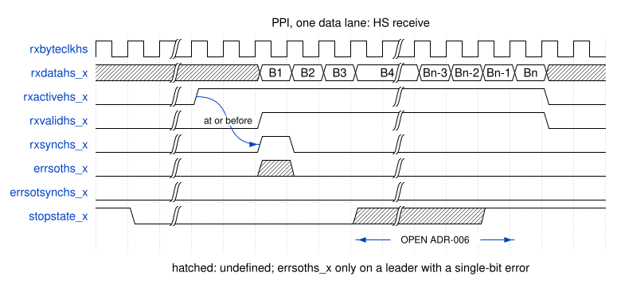

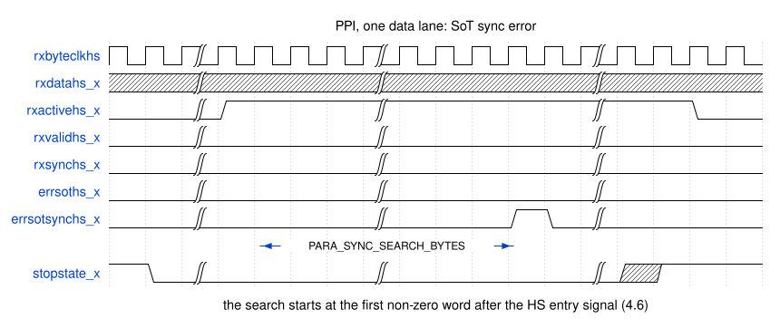

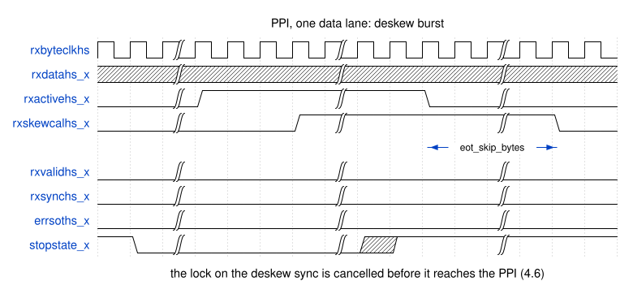

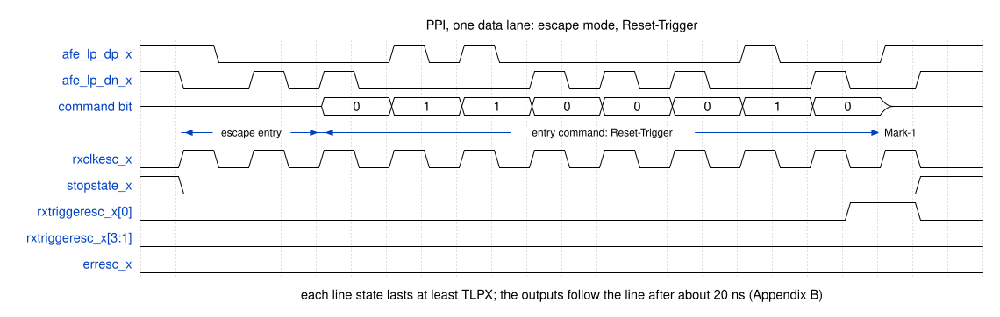

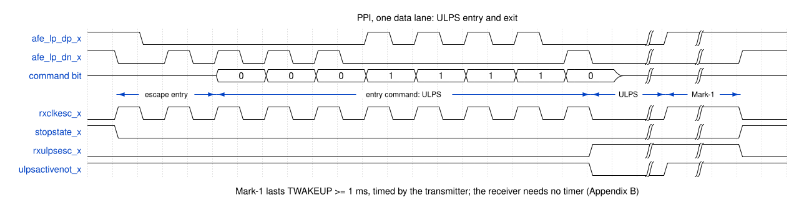

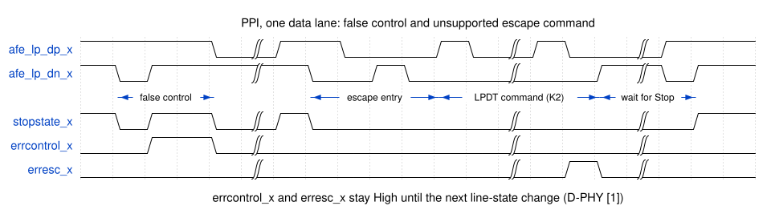

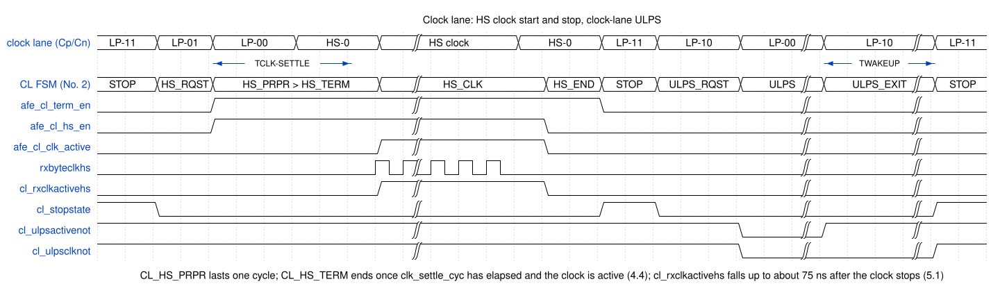

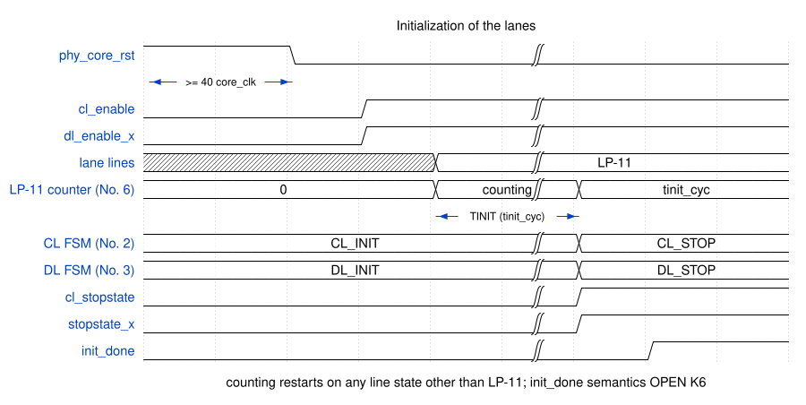

### 5.2 AFE interface (proposed, OPEN ADR-001)

Assumes the AFE delivers deserialized, **unaligned** 8-bit words per lane on a common byte clock
(ADR-001 option B).

**Table 5-2 — AFE interface signals**

| Signal | Dir | Width | Domain | Description |
|---|---|---|---|---|
| `afe_lp_dp_x`, `afe_lp_dn_x` | In | 1 each | async | LP-RX outputs of data lane x |
| `afe_cl_lp_dp`, `afe_cl_lp_dn` | In | 1 each | async | LP-RX outputs of the clock lane |
| `afe_byteclk` | In | 1 | clock | Clock-lane DDR clock divided by 8; becomes `rxbyteclkhs` |
| `afe_hs_word_x` | In | 8 | `afe_byteclk` | Raw deserialized bits, bit 0 received first, arbitrary byte phase, fixed latency (word latency Λ below) ⚠️ |
| `afe_cl_clk_active` | In | 1 | async | Clock-activity detector for TCLK-MISS (§4.4 note) ⚠️ |
| `afe_hs_en_x`, `afe_cl_hs_en` | Out | 1 each | `core_clk` | HS-RX (and deserializer) enable |
| `afe_term_en_x`, `afe_cl_term_en` | Out | 1 each | `core_clk` | HS termination enable |
| `afe_dly_tap_x` | Out | `PARA_DLY_TAP_WIDTH` | `rxbyteclkhs` | Delay-line setting (R2) |

**Timing at the AFE interface** (Figure 5-9, not to scale; D-PHY v1.1 Figure 14 ✅).
- SoT. `afe_term_en_x` rises in DL_HS_PRPR, about 25 ns after the start of LP-00, within
  TD-TERM-EN (35 ns + 4·UI). `afe_hs_en_x` and the HS entry signal follow in DL_HS_TERM, about
  35 ns after the start of LP-00, and DL_HS_RX starts `hs_settle_cyc` cycles later with the
  sync-search start (Appendix B).
- Word latency Λ: byte clocks from the last bit of a word at the line to that word in the Block No. 1
  register, AFE included. Λ = 2 is assumed ⚠️ (OPEN ADR-007, AFE team); `hs_settle_cyc` depends on it.
- Both signals reach Block No. 4 2–3 byte clocks later (§4.1). The first word searched began at the
  line between Λ and Λ − 1 byte clocks before the entry into DL_HS_RX, so the AFE words during
  THS-PREPARE are ignored (§4.6).
- EoT. LP-11 moves the lane to DL_HS_EOT, which clears both AFE enables and raises the EoT request;
  EoT done returns the lane to DL_STOP (§4.5, §4.6). The PPI outputs of the burst follow
  `PARA_EOT_DELAY_BYTES` byte clocks later (Figure 5-1).

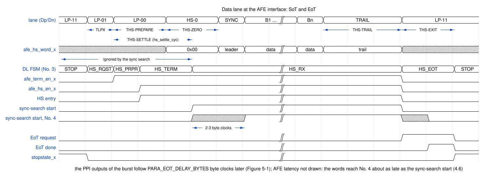

### 5.3 Configuration and status interface

OPEN K3 / ADR-005. Draft assumption: a dedicated APB subordinate in Block No. 8.

---

## 6. Registers

Deferred until ADR-005 is agreed and the CSI-2 controller register map
(`FTEL_MEMORY_MAP_REGISTERS_v1_4.xlsx`, OPEN K5) is available. The fields to be exposed are listed
in §3 and §4.10.

---

## 7. Design Decisions

Scores 1–5; weight in brackets.

### ADR-001 — AFE boundary (proposed: B, OPEN with the AFE team)

**Table 7-1 — ADR-001: AFE boundary options**

| Criterion (weight) | A: AFE gives serial HS bits + DDR clock | **B: AFE gives unaligned 1:8 words + byte clock** | C: hard PHY up to PPI (vendor macro) |
|---|---|---|---|
| Timing feasibility at 1.5–1.8 Gb/s (5) | 1 | 5 | 5 |
| Portability across AFE / process (3) | 3 | 4 | 1 |
| Deskew support in R2 (3) | 2 | 4 | 5 |
| Verification effort (2) | 4 | 4 | 3 |
| Protocol logic owned in RTL (3) | 5 | 5 | 1 |
| **Total** | 43 | **72** | 52 |

Still to agree with the AFE team: clock-activity detection (TCLK-MISS), termination timing and the
delay-tap interface.

### ADR-002 — LP and escape reception (decided in this draft: A)

**Table 7-2 — ADR-002: LP and escape reception options**

| Criterion (weight) | **A: oversample LP lines in `core_clk`** | B: clock escape logic with XOR(Dp, Dn) |
|---|---|---|
| Robustness to glitches on LP lines (4) | 4 | 2 |
| STA / DFT friendliness (4) | 5 | 1 |
| Latency (2) | 3 | 5 |
| Matches HAS-CSI (escape data in `core_clk`) (2) | 5 | 2 |
| Area (1) | 3 | 5 |
| **Total** | **55** | 31 |

Basis: every LP state lasts at least TLPX = 50 ns (D-PHY Table 14 ✅), i.e. ≥ 10 samples at 200 MHz.

### ADR-003 — Release staging

R1 without deskew calibration, R2 with it (research plan §3.1). OPEN K1.

### ADR-004 — Deskew algorithm (R2)

Deferred: depends on the AFE delay line (ADR-001) and on the Tx deskew behaviour (S4). Constraint
fixed now: the R1 datapath already detects deskew bursts, so R2 only adds Block No. 5.

### ADR-005 — Configuration path (proposed: B, OPEN K3)

**Table 7-3 — ADR-005: configuration path options**

| Criterion (weight) | A: fields added to the CSI-2 controller CSR | **B: own APB subordinate** | C: synthesis parameters only |
|---|---|---|---|
| Programmability for rate changes (5) | 5 | 5 | 1 |
| Integration effort with the CSI team (3) | 2 | 4 | 5 |
| Independence and reuse of the PHY (3) | 2 | 5 | 3 |
| Area (1) | 5 | 3 | 5 |
| **Total** | 42 | **55** | 34 |

### ADR-006 — Trailer removal (decided: delay line + last transition, wait for EoT done; OPEN: cut below ~270 Mb/s, order at the PPI)

The PHY does not know packet lengths (it never parses content), so the only method that follows
D-PHY §6.4.3 ✅ is to buffer the tail of the burst and cut it at the last transition before the
THS-SKIP interval. Discarding a fixed number of bytes fails when the Tx trail length changes (V8).

Reopened by the block-level design (design notes of §4.5 and §4.6). Decided: DL_HS_EOT keeps waiting
for EoT done; §4.5 states the resulting rate limit and keeps not waiting as the faster option.
Still open: the precision of the cut below ~270 Mb/s and the order of `stopstate_x` and
`rxactivehs_x` at the PPI (CSI team).

### ADR-007 — Start of the sync search (decided: D)

Opened by the timing diagrams of v0.8 (Figure 5-9) and decided in v0.9 with a bit-level model of the
line, the AFE, the crossing and each option (`doc/analysis/adr007/`, results in `results.md` there).
D-PHY Table 14 ✅ requires the HS receiver to ignore Data Lane transitions before THS-SETTLE,min and
to respond to them after THS-SETTLE,max; until THS-SETTLE,min the AFE words may be junk (ADR-001).
- A (v0.8): the search starts with the HS entry signal (DL_HS_TERM), after an all-zero word.
- B: 8 zero bits followed by the leader, compared over three words; the search counter restarts on
  every all-zero word.
- C: a run-time field `hs_skip_bytes` skips the first words after the HS entry signal.
- **D: the search starts with the sync-search start (DL_HS_RX), and the words before it are ignored
  (§4.6).**
- E: the AFE forces its words to zero until DL_HS_RX (a new AFE behaviour).

**Table 7-4 — ADR-007: sync-search start options**

| Criterion (weight) | A | B | C | **D** | E |
|---|---|---|---|---|---|
| Ignores AFE words before THS-SETTLE,min and finds every leader, 80–2500 Mb/s (5) | 1 | 2 | 4 | 5 | 5 |
| Fallback without RTL change when an assumption fails (5) | 1 | 1 | 3 | 5 | 3 |
| No new obligation on another team (4) | 2 | 4 | 2 | 5 | 1 |
| No further rate-dependent field; every field does what its name says (3) | 3 | 3 | 1 | 5 | 5 |
| RTL complexity, area, timing (2) | 4 | 2 | 3 | 4 | 4 |
| Verification effort (2) | 3 | 2 | 3 | 4 | 3 |
| Behaviour after a corrupted leader (1) | 3 | 2 | 3 | 3 | 3 |
| **Total** | 44 | 50 | 61 | **104** | 76 |

Evidence, as failures per 1000 bursts in the worst case over Λ = 1 to 3:
- With AFE words of zero before HS-0, every option receives every leader, at 80 Mb/s too.
- With random or all-ones words up to THS-SETTLE,min:
  - A fails 1000 at every rate when HS-0 is long, and from 1 Gb/s also at the minimum HS-0.
  - B locks wrongly on 17–50 up to 1500 Mb/s, 208 at 1792 Mb/s and 1000 at 2500 Mb/s.
  - C with the v0.8 formula fails 741–1000.
  - D and E have no failure.
- C works only with values outside its v0.8 formula, and at 80–100 Mb/s with a single value,
  because it moves in steps of one byte clock. D moves in steps of 5 ns and has 10–15 passing values
  at every rate.
- D is not worse than another option on any criterion, so the order does not depend on the weights.

Corrections to v0.8: a quiet AFE causes no leader loss at low rates (v0.8 compared the arrival of the
HS entry signal with the line without the delay of the data path), and the AFE words before
THS-SETTLE,min were not ignored, so `hs_settle_cyc` had no effect on the search.

**Table 7-5 — ADR-007: events and fallbacks**

| Event | A | B | C | **D** | E |
|---|---|---|---|---|---|
| AFE junk up to THS-SETTLE,min, all ones included | fails | fails | new value | works | works if the AFE does it |
| Word latency Λ differs from the value assumed | works | works | new value | works from ~300 Mb/s, new value below | works |
| Junk 20–40 ns beyond THS-SETTLE,min (non-compliant AFE) | fails | fails | new value | new value | new value |
| Line rate anywhere in 80 Mb/s to 2.5 Gb/s (K1) | fails with junk | fails from 1792 Mb/s with junk | works; one or two values below 200 Mb/s | works | works |
| THS-ZERO at the minimum or much longer (S5) | fails with junk | works | works | works | works |
| No software path for PHY timing (K3) | works | works | one more field to default | works | works |
| Sync errors at bring-up | no knob | no knob | knob in byte-clock steps | `hs_settle_cyc`, 5 ns steps | depends on the AFE |

"New value": a programmed value changes, the RTL does not. Fallbacks of D, in this order:
- reprogram `hs_settle_cyc`;
- if an AFE leaves junk after THS-SETTLE,min at low rates, add the 16-bit pattern of B behind the
  start (no failure in the model; not in the RTL);
- if the AFE team provides E, D stays correct with it;
- with a vendor hard PHY (ADR-001 C), Block No. 4 is bypassed.

Still open (OPEN ADR-007): the value of Λ (AFE team), and whether the CSI-2 controller needs
`errsotsynchs_x` after a corrupted leader that matches inside the payload (§4.6, CSI team).

---

## 8. Verification Requirement

- **Stimulus.** A specification-compliant Tx BFM is required. The example model in
  `ref/mipi_tx_dphy_model/` may be reused only after its deviations are corrected: the trail must
  be the flipped last bit, THS-EXIT must be ≥ 100 ns, and the clock must be in quadrature with the
  data (research plan R3).
- **AFE model.** A behavioural AFE model converts the line-level stimulus to the §5.2 interface, with
  a random byte phase per lane and programmable lane-to-lane skew.
- **Scenarios.**
  - 1/2/4 lanes, including bursts whose length is not a multiple of the lane count.
  - Rate sweep 80–1500 Mb/s (R1).
  - Timing corners of THS-SETTLE, TCLK-SETTLE and the trail length; at 80 Mb/s the minimum
    THS-PREPARE + THS-ZERO, and an HS-0 much longer than the minimum (§4.6).
  - Start of the sync search (ADR-007): AFE words during THS-PREPARE that are zero, random or all
    ones up to THS-SETTLE,min; word latency Λ from 1 to 3; the minimum and a long THS-PREPARE +
    THS-ZERO; every byte-clock phase. A sweep of `hs_settle_cyc` at each rate shall pass over a range
    that contains the Appendix B value (reference model: `doc/analysis/adr007`).
  - SoT with a single-bit error (`errsoths_x`); with a corrupted leader that matches no offset:
    exactly one `errsotsynchs_x` and no later `rxsynchs_x` (Figure 5-2); with a corrupted leader that
    matches inside the payload: `rxsynchs_x` at that offset and no `errsotsynchs_x`.
  - Deskew burst: no `rxvalidhs_x` after the cancelled lock, and `rxskewcalhs_x` after
    `rxactivehs_x` falls (Figure 5-3); a normal burst after all-ones AFE words during THS-PREPARE is
    not taken for a deskew burst.
  - Clock lane: TCLK-ZERO longer than TCLK-SETTLE + TCLK-MISS (Figure 5-7).
  - EoT on and off a byte boundary.
  - Clock-lane and data-lane ULPS entry/exit; the four triggers; unknown escape command
    (`erresc_x`); false control (`errcontrol_x`).
  - HS RX timeout and escape watchdog expiry.
  - P/N-swapped and remapped lanes, in both HS and LP.
  - Enables, `forcerxmode_x`, `phy_core_rst`, TINIT and `init_done`.
  - Deskew burst detection (R1) and calibration (R2).
- **PPI monitor.** Checks the relations of Figures 5-1 to 5-8 on every burst and LP sequence.
- **Integration.** Co-simulation with the CSI-2 Rx controller RTL, checking HAS-CSI Lane Management
  expectations: inter-lane divergence ≤ 6 byte cycles (C10) and no stuck `rxactivehs_x` (C11).
- **Coverage.** Every FSM state and transition of Blocks No. 2 and 3, every PPI error output, every
  lane count.

---

## 9. Open Items

**Table 9-1 — Open items**

| ID | Item | Default in this draft | Owner / with |
|---|---|---|---|
| K1 | Target line rate (1500 or 1792 Mb/s) and the release of 4K staggered HDR | R1 ≤ 1500 Mb/s | CSI team |
| K2 | LPDT ports: tie-off and clock domain | Tied 0 | CSI team |
| K3 / ADR-005 | Configuration path of the timers | Own APB subordinate | CSI team |
| K4 | Inter-lane byte divergence budget at the PPI | ≤ 6 byte cycles | CSI team |
| K5 | Register map v1.4 (PHY_CONFIG, PHY_STATUS, LANE_STATUS) | — | CSI team |
| K6 | `phy_core_rst` polarity and synchronicity; whether it is a reset-type port under the FX1 IP Wrapper Guideline (active-low `_n` at the wrapper); exact `init_done` and `forcerxmode_x` semantics | Active High, asynchronous; wrapper port active-low with the inverter inside `m_ftel_dphy_rx_wrap` | CSI team |
| K8 | Longest HS burst per lane over all sensor modes and lane/rate combinations (sizes `hs_rx_timeout_cyc`) | 5802-byte line at 80 Mb/s on one lane | CSI team |
| ADR-001 | AFE boundary, clock-activity detection, termination timing, delay taps, maximum LP glitch width | Option B | AFE team |
| ADR-004 | Deskew algorithm, tap resolution and periodic calibration (R2) | Centre of the passing window; initial calibration only | This IP, after ADR-001 and S4 |
| S4 | Tx deskew behaviour (initial / periodic, exact pattern) | D-PHY v1.2 pattern (🌐) | Tx side |
| S5 | Tx timing table, in particular the maximum THS-TRAIL (sizes `PARA_EOT_DELAY_BYTES`) | Specification minimums | Tx side |
| T1 | Mapping of the four trigger commands to `rxtriggeresc_x[3:0]` | Order of D-PHY Table 8 | Specification check |
| ADR-006 | EoT: cut precision below ~270 Mb/s; order of `stopstate_x` and `rxactivehs_x` at the PPI (HAS-CSI Figure 4-1); gap between bursts below ~240 Mb/s | Lane waits for EoT done (decided); `stopstate_x` may rise before the last byte, earlier than HAS-CSI Figure 4-1 (to confirm); limits in §4.5 and §4.6 | This IP, CSI team, Tx side |
| ADR-007 | Sync search, start decided (DL_HS_RX, option D): AFE word latency Λ, which places `hs_settle_cyc`; behaviour after a corrupted leader at the PPI (HAS-CSI Figure 4-2) | Λ = 2; `PARA_SYNC_SEARCH_BYTES` = 16 (§4.6) | AFE team (Λ); CSI team (corrupted leader) |

---

## Appendix A. Requirement Traceability

IDs refer to `DPHY_RX_RESEARCH_PLAN.md` §2.1 (Q) and §2.4 (C).

**Table A-1 — Requirement traceability**

| Requirement | Covered in |
|---|---|
| Q1 D-PHY v1.2 baseline | §1 (v1.1 behaviour + deskew, ADR-003/004) |
| Q2 Unidirectional slave, CIL-SFEN / CIL-SCNN | §4.4, §4.5 |
| Q3 Continuous clock mandatory | §4.4 |
| Q4 Forward escape ULPS on all data lanes | §4.5 |
| Q5 Deskew mechanism, bypassable | §4.6, §4.8, `PARA_DESKEW_EN` |
| Q6 N-lane Rx with M ≤ N lane Tx | `dl_enable_x`, §4.2 |
| Q7 EoT–LPS–SoT between packets | §4.5, §4.6 |
| Q8 D-PHY-level error reporting | §4.5, §4.6, §5.1 |
| Q9 ULPS and Triggers mandatory | §4.5 |
| C1 Baseline CSI-2 v1.3 + D-PHY v1.2 | §1.4 Baselines |
| C2, C3 Lanes and PPI width | §3 (#1, #2), §5.1 |
| C4 Rate envelope, deskew above 1.5 Gb/s | §1 release plan |
| C5 Continuous clock | §1, §4.4 |
| C6–C9 Burst signalling | §4.6 |
| C10 Inter-lane divergence | §8 integration check, K4 |
| C11 No stuck `rxactivehs_x` | §4.5 (timeout), §4.6 |
| C12, C13 Escape and LP error signalling | §4.5, §5.1 |
| C14–C16 Enables, reset, `core_clk`, init | §4.1, §4.2, §4.7 |

## Appendix B. Receiver Timing Parameters

From D-PHY v1.1 Table 14 ✅. `core_clk` period = 5 ns; the LP detection latency is
(`PARA_LP_SYNC_STAGES` + `PARA_LP_FILTER_CYC`) × 5 ns ≈ 20 ns with the defaults.

**Table B-1 — Receiver timing parameters**

| Parameter | Specification | Implementation |
|---|---|---|
| THS-SETTLE | 85 ns + 6·UI … 145 ns + 10·UI, from the start of THS-PREPARE | Ends the interval the sync search ignores (§4.6). DL_HS_RX is entered at t = 35 ns + 5 ns × `hs_settle_cyc` after the start of LP-00 (35 ns: LP-00 detection and DL_HS_PRPR); t shall lie in [85 ns + 6·UI + Λ·8·UI, 145 ns + 13·UI + (Λ − 1)·8·UI], Λ = word latency (§5.2). `hs_settle_cyc` = round((115 ns + 9.5·UI + (Λ − 0.5)·8·UI − 35 ns) / 5 ns), the centre. With Λ = 2 ⚠️: 80 Mb/s 70, 750 Mb/s 22, 1500 Mb/s 19, 1792 Mb/s 18 |
| TCLK-SETTLE | 95 … 300 ns | `clk_settle_cyc` = (~200 − 20) / 5 = 36, counted from entry into CL_HS_TERM |
| TD-TERM-EN | ≤ 35 ns + 4·UI | Issued on LP-00 detection (~20 ns) |
| TCLK-TERM-EN | ≤ 38 ns | Issued on LP-00 detection (~20 ns) |
| THS-SKIP | 40 … 55 ns + 4·UI | Bits discarded before the last-transition search (Block No. 4): `eot_skip_bytes` places the cut between 40 ns and THS-TRAIL,min before LP-11, exactly only above ~270 Mb/s (§4.6) ⚠️ |
| TCLK-MISS | ≤ 60 ns | AFE clock-activity detector (ADR-001) |
| TINIT (slave) | ≥ 100 µs | `tinit_cyc` = 20 000 |
| TLPX | ≥ 50 ns | Basis of the LP oversampling (ADR-002) |
| TWAKEUP | ≥ 1 ms | Tx-side; the Rx leaves ULPS on Mark-1 then Stop, no timer needed |

## Appendix C. Acronyms

| Acronym | Description |
|---|---|
| ADR | Architecture decision record (chapter 7) |
| AFE | Analog front-end: HS-RX, LP-RX, termination and deserializer, outside this IP |
| APB | AMBA Advanced Peripheral Bus |
| BFM | Bus functional model (verification stimulus) |
| CIL | Lane Control and Interface Logic of a D-PHY lane module |
| CIL-SCNN | Clock lane module of the slave side (D-PHY v1.1 §5.6.3) |
| CIL-SFEN | Data lane module of the slave side: forward-only high-speed, escape mode with events only, no reverse escape |
| CRC | Cyclic redundancy check of a CSI-2 packet |
| CSI-2 | MIPI Camera Serial Interface 2 |
| [CSI] | Requirement taken from HAS-CSI |
| CSR | Control and status register |
| D-PHY | MIPI D-PHY physical layer |
| DDR | Double data rate (the HS clock); DDR memory in Figure 1-1 |
| DFT | Design for test |
| ECC | Error-correcting code of a CSI-2 packet header |
| EoT | End of transmission (of an HS burst) |
| FSM | Finite state machine |
| FX1 | The receiving SoC that integrates this IP |
| HAS | High-level architecture specification |
| HAS-CSI | HAS of the CSI-2 Rx controller, FTEL_IP_MIPI_CSI-2_CONTROLLER_HAS_v1.2 |
| HDR | High dynamic range |
| HS | High-speed mode of a lane |
| HS-RX, HS-TX | High-speed receiver, transmitter |
| IP | Intellectual property block |
| ISP | Image signal processor |
| LP | Low-power mode of a lane |
| LP-RX, LP-TX, LP-CD | Low-power receiver, transmitter, contention detector |
| LP-xy | Low-power line state, Dp = x and Dn = y (for example LP-11 = Stop) |
| LPDT | Low-power data transmission |
| MIPI | MIPI Alliance, owner of the CSI-2 and D-PHY specifications |
| OPEN | Open point, tracked in chapter 9: Kx with the CSI team, Sx with the Tx side, ADR-nnn a design decision |
| PCB | Printed circuit board |
| PHY | Physical layer |
| PPI | PHY-Protocol Interface between the D-PHY and the CSI-2 Rx controller |
| R1, R2 | Releases of this IP (§1.4) |
| RTL | Register-transfer level |
| SoC | System on chip |
| SoT | Start of transmission (of an HS burst) |
| STA | Static timing analysis |
| TBC | To be confirmed: an assumption or proposal of this draft, not yet agreed (marked with a warning sign in the Markdown source) |
| THS-x, TCLK-x, TLPX, TINIT, TEOT, TWAKEUP | D-PHY timing parameters (Appendix B, D-PHY v1.1 Table 14) |
| UI | Unit interval: one bit time on a lane |
| ULM | Universal Lane Module of D-PHY |
| ULPS | Ultra-low power state |
| VOD | Differential voltage of the HS signal |
